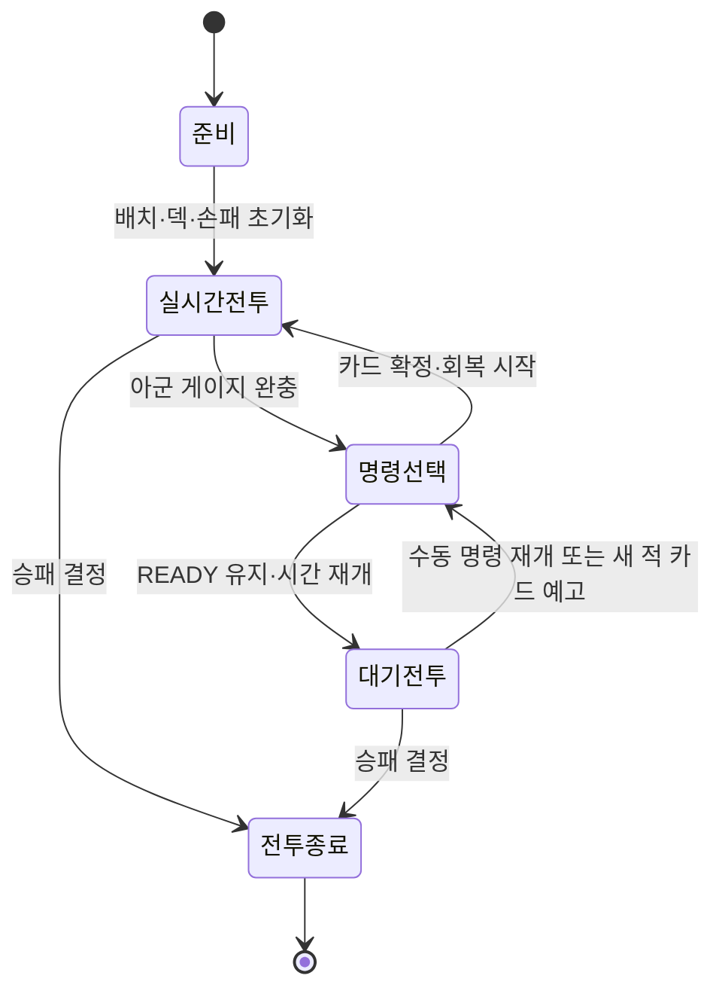

# 전투와 출정 베이스 시스템 설계 v0.9 · 이전 규칙 기록

작성일: 2026-10-05

2026-10-06 갱신 안내: 이 문서는 초기 인터뷰와 영구 카드 수집 규칙을 보존한 기록이다. 최신 기본 구조는 [게임 기본 구조 v1.0](게임_기본_구조.md), 캐릭터·기초 카드·원정 보상·정산은 [캐릭터와 원정 카드 설계](캐릭터와_원정_카드_설계.md)를 따른다. 아래의 영구 카드 수집·중간 확보·미확보 손실 규칙과 관련 데이터 계약은 새 설계에서 대체됐다. 전투의 자동 정지는 선택형 수동 운영의 규칙이며, 오토는 [자동 운영 기록](전투_자동_운영.md)을 따른다. 아래에서 ‘합의’와 ‘현재’라고 표현한 내용은 작성 당시의 상태다.

범위: 엔진에 독립적인 PvE 전투와 반복 출정의 설계. 실행 가능한 게임이나 최종 밸런스의 구현 완료를 뜻하지 않는다. 전체 흐름은 [게임 기본 구조](게임_기본_구조.md)에서 먼저 읽을 수 있다.

## 1. 설계의 기준

플레이어는 스스로 싸우는 파티의 전투 방침을 조정하고, 공용 행동 게이지가 차면 정지한 전장에서 카드 한 장으로 명령한다. 적군도 기본 행동과 카드 행동을 가지며 AI가 조종한다.

이 문서에서 규칙의 지위는 다음과 같다.

- **합의:** 사용자와의 대화에서 이미 정해진 방향. 인터뷰에서 반복해서 묻지 않는다.
- **초안:** 구현과 검증을 위해 채운 기본값. 사용자가 승인한 확정 사항으로 취급하지 않는다.
- **중요 결정:** 재미와 구조를 크게 바꾸는 사항. 초안으로 연결해두되 이후 인터뷰에서 결정한다.

### 합의된 골격

1. 전투는 실시간이며, 아군과 적군은 명령이 없어도 움직이고 싸운다.
2. 플레이어는 캐릭터를 WASD나 공격 버튼으로 직접 조작하지 않는다.
3. 아군은 공용 행동 게이지, 공용 덱, 공용 손패를 사용한다.
4. 아군 게이지 완충 시 자동으로 시간이 정지한다. 선택 시간 제한은 없다.
5. 카드 한 장을 고르면 그 카드의 캐릭터와 기술이 함께 선택된다.
6. 카드 확정 후 시간이 재개되고, 다른 아군과 적도 계속 행동한다.
7. 카드에는 별도의 MP, 스태미나, 캐릭터별 행동력, 개별 기술의 재사용 쿨타임, 궁극기 게이지를 두지 않는다.
8. 기술의 사용 가능 여부는 손패와 유효성으로 관리한다. 같은 카드가 다시 손패에 오면 다음 명령 기회에 다시 쓸 수 있다. 명령 기회 사이의 간격은 사용한 카드가 결정한다.
9. 기본 행동은 지속적인 전투 방침이다. 변경 명령에는 공용 게이지가 필요하지 않다.
10. 기본 행동 변경은 현재 행동 종료 후 적용하는 방향이며, 캐릭터마다 우선 두 가지 방침을 둔다.
11. 카드는 강한 공격, 전체 회복 등 직접적인 일회성 효과를 발휘한다. 기본 행동 변경과 구별한다.
12. 아군과 적군 모두 기본 행동과 카드 행동을 가진다. 적의 게이지·덱·발동 시점까지 동일하다는 것은 아직 합의되지 않았다.
13. 스타일라이즈드 3D 캐릭터의 움직임과 액션이 중요하다. 평상시에는 UI보다 전장을 보게 한다.
14. 카드마다 파티 전체의 다음 카드 선택까지 걸리는 시간이 다르다. 캐릭터의 카드 액션 수행 시간과 별개인 공용 명령 회복 시간이다.
15. 전장은 자유로운 위치·거리 방향으로 설계하며, 전투 중 평상시 이동은 캐릭터가 태세에 따라 판단한다. 개별 캐릭터의 이동 위치를 반복 지정하는 조작보다 카드 활용에 초점을 맞춘다.
16. 카드의 대상 지정은 자동 추천 후 변경 가능한 방식이다. 플레이어는 추천을 그대로 확정하거나 다른 대상·범위로 바꿀 수 있다.
17. 카드 실행은 안정적인 성공을 기본으로 하되, 일부 기술에는 명시적인 회피·중단 가능 조건을 둔다.
18. 명중이 보장되는 공격도 상대의 카드 방어로 대응할 수 있다. 명중 여부와 타격 시점의 방어·피해 판정은 구분하며 양쪽 진영에 같은 원리를 적용한다.
19. 플레이어가 캐릭터별 카드 목록에서 사용할 카드와 장수를 선택하고, 선택한 카드들을 합쳐 하나의 파티 덱을 만든다. 같은 파티도 카드 구성에 따라 다르게 운용할 수 있다.
20. 캐릭터 레벨에는 상한이 있다. 반복해서 몇 번 플레이하면 각 캐릭터를 비교적 쉽게 육성할 수 있는 방향으로 설계한다.
21. 지속적인 캐릭터 성장의 중심은 해당 캐릭터의 카드 수집이다. 레벨 성장과 장기적인 카드 수집을 구분한다.
22. 카드 수집은 새로운 기술·조합의 확대를 중심으로 한다. 카드 성능이 좋아지는 성장도 포함하며, 강화 노드에서 얻는 진화는 출정 한정 성장으로 구분한다.
23. 반복 플레이는 한 번 출정해서 여러 전투와 선택을 거친 뒤 종료하고 다시 준비하는 흐름이다. 분기 경로와 출정 내 성장으로 로그라이크 느낌의 기본 구조를 만든다.
24. 출정 중간 지점에서 새 카드 일부를 확보한다. 이후 실패해도 확보한 카드는 유지하고 아직 확보하지 못한 카드만 잃는다.
25. 카드 보상은 제시된 후보 중 원하는 카드를 선택하는 방식이다. 후보 수와 지급 수량은 설계 초안으로 정한다.
26. 출정 덱의 기본 카드 한 장씩 성능이 더 좋은 강화 카드로 진화시킨다. 각 카드의 진화는 현재 출정마다 최대 한 번이며, 같은 기술의 기본 카드와 강화 카드가 함께 존재할 수 있다.
27. 진화 기회는 카드를 강화할 수 있는 노드 또는 방에서 제공하는 방향이다. 재료 수집보다 강화 장소를 만나는 경험을 중심으로 둔다.
28. 카드 진화는 이번 출정에서만 유지하는 성장이다. 성공·실패로 출정이 끝나면 초기화한다. 중간 확보 지점에 도착해도 강화 결과가 영구 보유 목록에 저장되지는 않는다.
29. 출정 중 전투 사이에 아군의 남은 HP와 전투불능 상태를 유지한다. 다음 전투에 자동으로 전원 최대 HP로 복귀하지 않으며, 회복·부활 기회가 파티 운영에 영향을 준다.
30. 새 카드는 전투를 마친 뒤 받는 보상 또는 보상을 얻는 방에서 획득한다. 패배는 기존 실패 규칙을 따르며, 전투 보상은 승리 시 제공하는 초안이다.
31. 획득한 새 카드는 다음 전투부터 사용할 수 있다. 중간 확보 지점에 도착하기 전에도 덱 편성이 가능하며, 사용 가능 시점과 영구 확보 시점은 구분한다.
32. 출정에 가져가는 덱의 카드 장수에는 제한이 있다. 새 카드를 얻어도 덱을 무제한으로 늘리지 않고 정해진 장수에 맞춰 편성한다. 정확한 제한 수치는 설계자가 채운다.
33. 전체 덱 장수 안에서 캐릭터별 카드 비율을 자유롭게 정한다. 캐릭터마다 같은 장수를 넣을 의무는 없으며, 새 카드의 시전 캐릭터가 교체할 기존 카드의 시전 캐릭터와 같을 필요도 없다.
34. 출정 중 분기 경로에서 다음 방으로 향하는 길을 플레이어가 선택한다. 파티 상태와 원하는 카드·강화를 고려해 경로를 정한다.
35. 기본 게임 구조는 로그라이크의 느낌을 지향한다. 여러 번 출정하며 이번 출정의 선택과 성장을 만들고, 확보한 카드 수집은 장기 성장으로 연결한다.

이번 대화에서 사용자가 제안한 **대기**를 베이스에 추가한다. 명령 기회가 왔을 때 바로 카드를 사용하지 않고, 그 기회를 유지한 채 전투 시간을 진행시키다가 적의 행동에 맞춰 명령한다. 아래의 버튼·자동 재정지 방식은 설계자가 채운 초안이다.

## 2. 먼저 채워놓는 기본값

모든 숫자는 검증 시작점이다. 손패 수, 충전 시간, 피해 수치 등을 사용자에게 일일이 결정하도록 요구하지 않는다.

| 항목 | v0.9 초안 | 적용 의도 |
|---|---|---|
| 아군 인원 | 4명 | 기존 논의의 기본 가정을 사용 |
| 기본 행동 | 캐릭터당 2종 | 화면에서 구분되는 전투 방식 |
| 아군 덱 | 총 20장, 캐릭터별 비율 자유 | 공용 순환을 작게 시작하고 시전자 비중을 선택 |
| 손패 | 5장 | 매 명령마다 선택 가능한 대안 확보 |
| 시작 손패 | 덱을 섞어서 5장 | 첫 패 보정은 우선 넣지 않음 |
| 카드 사용 | 명령 기회당 1장 | 선택 하나의 결과를 명료하게 함 |
| 보충 | 카드 확정 직후 빈칸만큼 드로우 | 항상 같은 크기의 손패 유지 |
| 덱 소진 | 버림패를 섞어 새 덱으로 사용 | 별도 턴 종료·패널티 없음 |
| 손패 유지 | 사용하지 않은 카드는 유지 | 다음 명령을 계획할 수 있음 |
| 아군 게이지 | 첫 충전 6초, 이후 사용한 카드의 회복 시간 | 카드 선택으로 다음 개입 시점도 결정 |
| 게이지 초기화 | 카드 확정 시에만 0 | 대기는 명령 기회를 소비하지 않음 |
| 대기 | READY 100% 유지, 실시간 전투 재개 | 적의 행동에 맞춰 명령 시점 선택 |
| 대기 종료 | 수동 명령 재개 또는 새 적 카드 예고 시작 시 재정지 | 빠른 반응 입력 부담 완화 |
| 적 카드 | 독립적인 적 공용 게이지로 발동 | 카드별 회복 시간과 대기를 전제로 A 방향 사용 |
| 적 게이지 | 첫 충전 8초, 이후 사용한 카드의 회복 시간 | 양측 카드 선택에 따라 명령 시점이 달라짐 |
| 적 카드 예고 | 공격 기술은 기본 1.5초, 실제 준비 시간은 카드 데이터 사용 | 빠른 방어 기술도 양측 동일한 준비 시간 적용 |
| 기본 행동 전환 | 최신 예약 하나, 안전한 행동 경계에서 적용 | 행동 취소로 이득을 중복 취하지 않음 |
| 카드 접근 시간 | 최대 1.5초 | 무한 추적 방지 |
| 카드 총 수행 시간 | 최대 5초이면서 해당 카드의 명령 회복 시간 이하 | 초기 콘텐츠에서 같은 시전자의 명령 중첩 방지 |
| 승리 / 패배 | 적 전원 전투불능 / 아군 전원 전투불능 | 첫 검증을 단순하게 유지 |

적 인원과 적 덱 크기는 전투별 데이터로 둔다. 첫 검증 전투는 아군 4명과 역할이 다른 적 3명을 사용하며, 적 캐릭터당 카드 5장과 공용 손패 5장을 임시 적용한다.

### 카드별 다음 명령 시간

카드 데이터에 `commandRecoverySeconds`를 둔다. 카드 확정 시 해당 값을 진영의 현재 충전 시간으로 설정하고 게이지를 0으로 초기화한다. 전투 시간으로 그 시간이 지나면 다시 READY가 된다. 회복은 카드 확정 순간부터 시작하며 접근·시전·연출 중에도 진행된다.

예시: 빠른 일격 3초, 강격 6초, 전체 회복 8초. 이는 설명용 수치다. 효과 발생 시간과 명령 회복 시간은 별도 데이터다. 전체 회복 효과가 0.5초 뒤 발생해도 다음 명령은 8초 뒤에 열린다.

대기로 3초를 기다린 후 회복 시간 5초의 카드를 사용하면, 지금부터 8초 뒤에 다음 명령이 열린다. 대기 시간은 아직 사용하지 않은 카드의 회복 시간을 미리 채워주지 않는다. READY는 하나만 보유하며 여러 명령 기회를 축적하지 않는다.

## 3. 전투의 전체 흐름

### 준비

캐릭터·진영·HP·초기 위치·초기 방침·덱을 설정한다. 출정 중 아군의 HP와 전투불능 여부는 출정 상태에서 불러온다. 살아 있는 캐릭터만 전장에 배치하고, 전투불능 캐릭터의 카드는 일시 제외한다. 강화 상태를 반영한 출정 덱에서 사용 가능한 카드를 섞고 손패를 뽑는다. 모든 게이지를 0에서 시작하고 첫 충전 시간을 진영별로 설정한다. 단독 검증 전투는 전원이 최대 HP인 출정 시작 상태를 사용한다.

### 실시간 전투

- 아군은 기본 행동 AI로, 적군은 기본 행동 AI와 카드 선택 AI로 움직인다.
- 플레이어는 아군의 기본 행동 변경을 예약할 수 있다.
- 카드 명령을 수행하는 동안에도 양측 게이지는 충전된다.
- 아군 게이지가 완충되면 즉시 명령 선택 상태로 넘어간다. 카드 액션 도중이라도 현재 상황 그대로 정지한다.

### 명령 선택

- 전체 전투 시간을 정지한다.
- 손패 확인, 카드 선택 취소, 대상 미리보기에는 비용이 없다.
- 기본 행동 변경도 예약할 수 있으나 실제 반영은 시간 재개 후 이루어진다.
- 카드 확정 시 명령 생성, 카드 소비, 게이지 초기화, 손패 보충을 한 번에 처리한다.
- 다음 충전 시간은 확정한 카드의 `commandRecoverySeconds`로 설정한다.
- 다음 시뮬레이션 단계부터 시간이 재개된다.

### 대기

**명령선택 → 대기전투**로 전환하며, 게이지는 READY 100%를 유지한다. 아군과 적군은 기본 행동과 이미 확정된 카드 행동을 계속한다. 태세 변경도 평소처럼 예약할 수 있다.

- 카드·게이지를 소비하지 않고 손패를 교환하거나 드로우하지 않는다. 전투불능으로 인한 손패 정리·보충은 정상 적용한다.
- 대기 중에는 **명령** 버튼으로 언제든 현재 시점에 다시 정지하고 카드 선택으로 돌아올 수 있다. 정지 버튼은 READY일 때만 사용할 수 있다.
- 새 적 카드의 준비/예고가 시작되면 자동으로 재정지한다. 기본 공격 하나하나에는 반응하지 않는다.
- 대기 전에 이미 시작한 예고는 새 사건으로 취급하지 않는다. 같은 예고에서 다시 대기를 선택해도 즉시 재정지하지 않는다.
- 재정지 여부는 적 명령 ID와 예고 시작 사건으로 관리한다. 정지·대기 반복으로 동일 사건이 다시 발생하지 않는다.
- 일반적인 완충 자동 정지는 게이지가 미완충에서 완충으로 바뀌는 사건에만 반응한다. 대기 중 매 프레임 READY를 검사해 다시 멈추지 않는다.
- 충전 중에는 대기를 통해 READY를 얻거나 적 예고 때문에 무료 명령 기회를 받지 않는다.
- 재정지해도 아직 카드를 소비하지 않았으므로 같은 명령 기회에서 한 장만 사용한다.

대기는 전원이 아무 행동도 하지 않는 명령이 아니다. 준비된 카드 명령을 보유하면서 자동 전투를 계속 관찰하는 상태다. 대기 동안 아군은 피해를 받을 수 있고, 먼저 공격하거나 회복할 기회를 늦춘다.

초기 자동 재정지 시점은 **적 카드 예고 시작**으로 둔다. 적의 효과 발생 직전에 정지해도 아군 카드의 기본 행동 대기·접근·준비 시간이 사라지지는 않는다. 적 행동 직전까지 기다리는 선택은 수동 명령 재개로 가능하지만 성공을 보장하지 않는다. 적 행동 이후의 회복도 수동 재정지로 선택할 수 있다. 이미 발생한 타격을 되돌리지 않는다.

v0.1의 ‘보류 시 게이지 0 초기화’ 초안은 이 대기 기능으로 대체한다. 첫 베이스에서는 별도의 게이지 소모 패스 버튼을 두지 않는다.

### 전투 종료와 출정 복귀

승패가 확정되면 새로운 행동·카드 명령과 전투 시간 진행을 종료한다. 같은 시각의 효과와 전투불능 판정이 끝난 뒤 아군의 HP·전투불능 상태를 출정 데이터에 기록하고, 아직 발생하지 않은 카드 효과와 일회성 전투 상태는 정리하는 초안이다.

승리하면 현재 파티 상태로 전투 사이의 노드나 보상 화면에 진입한다. 다음 전투에서는 손패·버림패·게이지를 새로 구성하되 HP·전투불능 상태와 출정 한정 강화는 이어진다. 아군 전원이 전투불능이면 출정 실패로 처리하며 이후 회복 노드에 진입하지 않는다.

## 4. 시간과 처리 순서

게임의 모든 전투 규칙은 하나의 **전투 시간**을 사용한다.

정지 대상은 이동, 공격 진행, 피해 발생, 양측 게이지, 적 카드 예고, 상태 지속시간, 기본 행동 AI와 적 카드 AI다. UI 선택과 설명창 애니메이션만 실제 시간으로 동작할 수 있다. 연출용 카메라 이동이 전투 시간을 임의로 바꾸지는 않는다.

한 시뮬레이션 단계에서 다음 순서를 고정한다.

1. 기존 행동·게이지·상태의 시간을 진행한다. 대기 중 아군 게이지는 100%에서 유지한다.
2. 같은 전투 시각에 발동하는 방어 효과를 먼저 활성화한 뒤, 예약된 타격의 명중·방어·피해와 회복을 처리한다. 피해와 회복은 같은 시각의 효과끼리 묶어서 반영한다. 공격 판정 뒤에 선택한 방어를 소급 적용하지 않는다.
3. 전투불능, 대상 무효화, 손패 정리, 승패를 판정한다.
4. 전투가 계속되고 적이 READY라면 판단 주기 또는 전장 변화에 맞춰 카드 AI를 평가하고, 유용한 명령이 있을 때 확정한다.
5. 아군 게이지가 새로 완충되었다면 자동 정지한다. 이미 READY를 보유한 대기 상태에서는 이 조건으로 다시 정지하지 않는다.
6. 계속 실시간 상태라면 새 기본 행동과 예약된 카드 행동을 시작한다.
7. 대기 중 새 적 카드 예고가 시작되었다면 효과 발생 전에 자동 재정지한다. 초기 적 카드에는 양의 준비 시간을 반드시 둔다.

같은 단계에서 적의 명령과 아군 READY가 발생하면, 적의 명령이 먼저 고정되고 정지 화면에 표시된다. AI가 플레이어의 정지 중 선택을 보고 명령을 다시 바꾸지 않는다. 양측 전원 전투불능이 동시에 발생하면 첫 버전에서는 패배로 처리한다.

## 5. 캐릭터의 행동 구조

캐릭터가 들고 있는 핵심 상태는 현재 방침, 예약 방침, 현재 행동, 카드 명령, HP, 위치, 전투불능 여부다. 캐릭터별 행동 게이지나 카드 덱은 없다.

행동 우선순위는 다음과 같다.

1. 전투불능 처리
2. 현재 수행 중인 카드 행동
3. 예약된 카드 명령
4. 예약된 기본 행동 전환
5. 현재 방침에 따른 새 기본 행동

이미 시작한 기본 공격은 준비·타격·회복까지 짧은 행동 단위로 마무리한다. 카드가 예약되면 이 단위가 끝난 뒤 카드로 넘어간다. 베이스의 기본 공격 단위는 최대 1초로 설계한다.

이동과 추적은 무한히 지속되는 하나의 행동으로 취급하지 않는다. 이동 중 방침 변경이나 카드 명령은 다음 AI 판단 주기, 기본 0.2초 이내에 반영한다. 연속 입력을 통해 더 빠르게 판단하게 만들지는 않는다.

카드 행동이 끝나면 최신 예약 방침을 적용하고 기본 행동으로 돌아간다. 다른 카드 명령이 현재 카드 행동을 덮어쓰거나 취소하지 않는다. 초기 콘텐츠는 총 수행 시간이 해당 카드의 명령 회복 시간 이하인지 검증해 같은 시전자의 명령 중첩을 방지한다. 장시간 카드, 게이지 가속, 행동 지연 효과를 추가해 이 조건이 깨지면 명령 대기열 규칙을 별도로 확장한다.

## 6. 기본 행동 전환

기본 행동은 짧은 버프 토글이 아니라 **목표 선정·이동·공격·보호 방식이 묶인 방침**이다.

| 역할 | 방침 A | 방침 B | 선택의 대가 |
|---|---|---|---|
| 방패병 | 보호: 가까운 아군 앞에 위치하고 피해 일부를 대신 부담 | 압박: 적에게 접근해 방패 공격과 짧은 밀치기 | 보호 범위를 유지할지, 적을 밀어낼지 |
| 검사 | 견제: 아군 전열 근처에서 가까운 적을 공격 | 추격: 위험한 적을 따라가 적극적으로 공격 | 전열 안정성 또는 적 후방 압박 |
| 사수 | 기동 사격: 거리를 벌리면서 비교적 약한 공격 | 집중 조준: 이동을 줄이고 강한 사격 | 생존·거리 유지 또는 공격 효율 |
| 지원가 | 지원: 가까운 부상 아군에게 약한 회복 | 방해: 적에게 약한 공격과 짧은 둔화 | 지속 회복 또는 적의 압박 완화 |

이는 역할을 검증하는 예시이며 세계관·최종 캐릭터 명단의 확정이 아니다. 지원 방침에서 회복 대상이 없으면 안전한 위치를 유지하며 약한 기본 공격을 수행한다.

### 방패병 어그로와 도발 실험

사용자는 검사가 먼저 표적이 되고 방패병에게 적의 공격을 옮기기 어렵다는 플레이 피드백과 함께 도발 카드 또는 패시브를 제안했다. 보호 태세는 적 기본 공격의 거리 평가에서 방패병의 거리를 0.65배로 계산하는 실험값을 적용한다. 주변에서 우선 표적이 되기 쉬우며 아주 가까운 다른 아군까지 항상 무시하지는 않는다. 이 패시브만으로 이미 확정된 카드 표적은 바뀌지 않는다.

도발 카드는 준비 0.2초, 지속 4초, 명령 회복 5초를 실험값으로 둔다. 효과가 실제 발동한 뒤 적 기본 공격을 자신에게 유도하고, 효과가 유효한 타격 시점의 적 단일 카드 공격도 자신에게 돌린다. 이미 예고된 공격에도 적용하되 범위 공격·회복·방어는 바꾸지 않는다. 도발 발동과 단일 타격이 정확히 같은 시각이면 도발을 먼저 처리한다. 만료하거나 방패병이 전투불능이면 강제 표적 유도는 해제되고 단일 카드 공격은 원래 지정 대상을 따른다. 이미 맞은 공격은 바꾸지 않는다.

프로토타입은 도발 두 장을 기존 방패병 카드와 교체해 총 덱 20장·역할별 5장 프리셋을 유지한다. 기본 공격 대상, 단일 카드 공격의 실제 예정 대상과 도발 남은 시간을 표시한다. 횟수·지속·거리 가중치는 설계자 실험값이며, 보호 위치 선정과 피해 대신 받기의 최종 AI는 별도 구현한다.

### 예약 규칙

- 예약은 캐릭터당 최신 하나만 유지한다.
- 현재 방침을 다시 선택하면 미적용 예약을 취소한다.
- 같은 방침을 반복 선택해도 행동을 다시 시작하지 않는다.
- 현재 행동의 효과는 **그 행동을 시작한 방침**으로 계산한다.
- 방침을 바꿔도 이미 진행 중인 공격에 보호 효과를 추가하거나 피해를 소급 변경하지 않는다.
- 보호 효과는 해당 방침의 보호 행동을 실제로 수행하는 동안 적용한다.
- 카드 행동 중에는 카드 데이터가 지정한 효과와 보호 조건을 따른다. 기존 보호 방침의 이득을 자동으로 중복 받지 않는다.

전환에 별도 쿨타임·자원·추가 게이지를 붙이지 않는다. 반복 전환이 최적이 되는지는 실제 전투에서 검증한다. 행동 종료 후 적용한다는 규칙만으로 반복 조작 문제가 해결됐다고 가정하지 않는다.

## 7. 카드 명령과 대상 지정

카드 선택과 동시에 시전 캐릭터가 정해지고, 현재 정지한 전장을 기준으로 유효한 대상 또는 범위를 자동 추천한다. 플레이어는 그대로 확정하거나 필요할 때 변경한다. 추천만으로 명령이 소비되거나 시간이 재개되지는 않는다.

| 대상 유형 | 조작 |
|---|---|
| 적 한 명 | 추천 적을 표시, 그대로 확정하거나 다른 적 선택 |
| 아군 한 명 | 추천 아군을 표시, 그대로 확정하거나 다른 아군 선택 |
| 자신 / 아군 전체 | 카드 선택 후 확정 |
| 범위 공격 | 추천 범위를 미리보기, 그대로 확정하거나 중심 변경 |

대상 지정이 없는 카드에도 오입력을 막는 확정 동작을 둔다. 캐릭터를 별도로 먼저 선택하는 단계는 만들지 않는다. 카드 선택을 취소하면 대상 미리보기를 제거하고 손패 선택 상태로 돌아간다.

추천 기준은 기술의 목적에 맞춰 채운다. 공격은 처치 가능성·위협·접근 가능성, 회복은 회복 가능한 HP와 위험, 보호는 위협받는 아군, 범위 공격은 실제로 포함되는 대상을 평가하는 초안이다. 추천 이유를 짧게 표시한다. 사용자가 바꾼 대상은 다시 자동 추천으로 덮어쓰지 않는다. 유효한 후보가 없으면 이유를 표시하고 비용 없이 다른 카드나 대기를 선택하게 한다.

카드에는 소유 캐릭터, 대상 유형, 접근 방식, 유효 거리, 준비 시간, 효과, 후속 동작, 실패 조건, 공용 명령 회복 시간을 데이터로 둔다. 거리 밖이라는 이유만으로 별도 자원이 필요하지는 않는다. 접근형 카드는 먼저 접근한 뒤 실행한다.

### 실행 단계

`확정 → 짧은 현재 기본 행동 완료 → 필요한 접근 → 준비/예고 → 효과 발생 → 후속 동작 → 기본 행동 복귀`

- 정지 중 미리보기에는 시전자, 대상·범위, 예상 접근 경로, 대상 추적 여부를 표시한다.
- 정지 시점에 이미 전투불능이거나 유효 대상이 없는 명령은 확정하지 않는다. 비용 없이 다시 선택한다.
- 접근 불가능한 위치는 미리보기에서 무효로 표시한다.
- 접근은 최대 1.5초다. 경로가 막히거나 접근 시간이 초과되면 실패한다.
- 전체 카드 수행은 현재 기본 행동 대기를 포함해 최대 5초이면서 해당 카드의 명령 회복 시간 안에 끝나도록 만든다. 3초 회복 카드에 5초짜리 수행을 그대로 배정하지 않는다.
- 확정 후 시전자가 전투불능이 되거나 대상이 사라지면 미발생 효과는 취소한다. 소비한 카드와 게이지는 돌려주지 않는다.
- 기본적인 지정형 기술은 살아 있는 지정 대상을 추적하고, 지면 범위형 기술은 고정된 범위에 실제로 들어온 대상에게 적용한다. 일부 기술의 회피·중단 조건은 카드에 표시한다. 명중 이후의 피해는 방어 효과를 별도로 반영한다.
- 단순히 아군 HP가 가득 찼다는 이유로 회복 카드를 막지는 않는다. 대신 낭비가 예상됨을 표시한다.

따라서 ‘손패에 있으면 사용 가능’은 MP·쿨타임 같은 추가 사용 자원이 없다는 원칙으로 적용한다. 시전자 존재·대상 유효성 같은 물리적 조건을 숨기지 않는다. 안정적인 실행과 일부 명시적인 위험을 조합하는 방향은 합의했으며, 개별 카드의 조건은 데이터로 채운다.

### 명중, 카드 방어, 시전 중단

이 셋은 독립적인 판정이다.

- **명중:** 지정 대상을 추적하는 기술인지, 실제 위치를 검사하는 범위 기술인지 확인한다. 명중 보장 기술은 유효한 지정 대상을 일반적인 이동만으로 놓치지 않는다.
- **방어:** 실제 타격 시점에 유효한 보호·피해 감소·차단 효과를 확인한다. 명중이 보장돼도 카드 방어가 적용된다.
- **중단:** 준비가 긴 일부 기술만 표시된 단계에서 특정 방해 효과로 취소할 수 있다. 일반 공격을 맞았다는 이유로 모든 카드 행동을 취소하지 않는다.

방어 카드를 사용하려면 방어측도 READY와 해당 손패를 보유해야 한다. 방어측이 이미 회복 중이면 피격을 이유로 무료 명령 기회를 받지 않는다. 공격과 방어 모두 정상적으로 카드를 소비하고, 각자 사용한 카드의 명령 회복 시간이 시작된다.

방어 카드도 정상적인 실행 단계를 따른다. 선택 또는 확정만으로 방어가 성립하지 않고 **타격 시점까지 방어 효과가 실제 발동해야 한다.** 준비·접근에 필요한 시간은 그대로 적용한다. 방어 효과의 발동 시간은 카드 미리보기에 알린다. 빠른 방어 카드의 준비 시간은 진영 구분 없이 카드 데이터로 결정한다. 공격 기술용 예고 기본값 1.5초를 모든 방어 기술에 강제하지 않는다.

카드 방어의 피해 감소율, 적용 대상·범위, 유지 시간, 차단 횟수는 카드 데이터로 둔다. 일반 피해 감소 상한과 별도로, 명시적인 완전 차단 효과가 해당 타격의 조건을 만족하면 피해를 0으로 만들 수 있다. 초기 완전 차단 효과는 짧은 효과 창 안에서 다음 유효 타격 한 번을 막는 방식으로 시작한다. 연속 타격에는 타격별로 방어를 판정하며 이를 카드 설명에 표시한다.

공격이 방어되거나 범위 밖으로 빗나가도 사용한 카드와 회복 시간을 돌려주지 않는다. 시전이 명시적인 방해로 중단돼도 동일하다. 이는 초안 소비 규칙이다.

아군과 적군 모두 이 규칙을 사용한다. 적 AI는 시간이 재개된 뒤 공개된 공격 준비와 대상·범위를 읽고, READY와 자신의 손패가 있다면 방어 카드를 선택할 수 있다. 이미 확정한 적 명령을 플레이어의 선택에 맞춰 다시 쓰거나 비공개 손패를 읽지는 않는다.

### 초기 카드 구성 예시

| 소유자 | 카드 2장 | 카드 2장 | 카드 1장 |
|---|---|---|---|
| 방패병 | 돌진: 접근 후 강한 단일 공격 | 긴급 보호: 가까운 아군들의 피해 일시 감소 | 충격파: 주변 공격과 밀치기 |
| 검사 | 강격: 강한 단일 공격 | 쓸어베기: 부채꼴 범위 공격 | 연속 베기: 단일 대상에 여러 타격 |
| 사수 | 정밀 사격: 강한 원거리 단일 공격 | 관통 사격: 직선 범위 공격 | 집중 포화: 지정 지면에 연속 공격 |
| 지원가 | 응급 치료: 아군 한 명 즉시 회복 | 약화 주술: 적의 공격 효과 일시 감소 | 전체 회복: 살아 있는 아군 모두 즉시 회복 |

20장의 덱을 12종 기술로 구성하는 시작 예시다. 공격·생존·범위·회복 선택을 함께 검증한다. 카드가 모두 적의 기술에 대한 대응 수단으로만 구성되지 않도록 한다.

### 전투 전 덱 구성

플레이어는 편성한 각 캐릭터의 사용 가능한 카드 목록에서 카드와 장수를 고른다. 선택한 카드는 해당 캐릭터를 소유자로 유지하며 하나의 파티 덱으로 합친다. 전체 덱 장수를 맞추면 캐릭터별 비율을 자유롭게 정할 수 있다. 초기 검증은 총 20장을 사용하며, 위의 5장씩 구성은 추천 프리셋이다. 파티 구성원은 출정 시작 후 종료까지 고정하는 초안이다. 카드 교체는 파티 구성원의 교체를 뜻하지 않는다.

예를 들어 7장·6장·5장·2장으로 편성하면 첫 캐릭터의 카드가 마지막 캐릭터보다 손패에 더 자주 등장하는 경향을 만든다. 모든 카드는 공용 명령 기회를 사용하므로 카드가 많은 캐릭터에게 별도 행동 게이지를 주지는 않는다. 배분은 실제 보유 장수와 카드 계열별 최대 장수 안에서 가능하다.

위의 20장 예시는 추천 시작 구성이다. 표의 같은 카드 2장은 선택된 수량이며 최대 허용 장수의 확정이 아니다. 덱 선택을 검증하는 첫 제한 초안은 일반 카드 최대 3장, 강한 특수 카드 최대 1장으로 둔다. 카드별 최대 장수는 데이터로 조정한다.

전투 전 카드 선택과 전투 중 손패 순환은 구별한다. 실시간 전투 중에는 카드 목록을 바꾸거나 편집으로 손패를 교체하지 않는다. 출정 중 새 카드를 얻으면 다음 전투 전에 편성할 수 있다. 덱 장수는 총 20장을 유지하는 초안이며, 새 카드 한 장을 넣을 때 기존 카드 한 장을 빼는 교체로 처리한다. 새 검사 카드를 넣으면서 사수 카드를 빼는 식의 비율 변경도 허용한다.

캐릭터별 최소 장수는 0장까지 허용하는 설계자 초안이다. 그 캐릭터는 태세와 기본 행동으로 계속 싸우며, 덱에 자신의 카드가 없으면 카드 명령을 맡지 않는다. 편성 화면에서 이를 표시하되 오류로 막지 않는다. 총 장수, 카드의 시전자와 파티 소속, 실제 보유 수량, 카드 계열 제한, 같은 보유 카드 ID의 중복 배치를 검증한다.

## 8. 덱과 손패의 수명

카드의 기본 이동은 `덱 → 손패 → 버림패 → 재섞인 덱`이다.

- 명령을 확정하면 해당 카드를 즉시 버림패로 옮긴다. 실행 실패여도 되돌리지 않는다.
- 빈 손패 칸을 즉시 보충한다. 덱이 비면 버림패를 섞어서 이어서 뽑는다.
- 방금 사용한 카드도 재섞기 대상이다. 곧바로 다시 손에 오는 경우를 허용한다.
- 매 명령 전체 손패 교체와 카드별 재사용 제한은 넣지 않는다. 제한된 한 장 교체는 아래 실험안을 적용한다.

### 제한된 손패 교체 실험

사용자는 마음에 들지 않는 카드 한 장을 횟수 제한 안에서 바꾸는 기능을 제안했다. 전투당 2회, 아군 READY의 정지 화면에서 선택한 한 장을 교체하는 규칙을 설계자 실험값으로 둔다. 시간과 명령 게이지는 유지하고 교체 횟수만 소비한다. 정확한 횟수와 비용은 플레이 결과에 따라 바꾼다.

덱에서 대체 카드를 먼저 뽑고 기존 카드를 버림패로 보낸다. 덱이 비면 기존 버림패를 섞는다. 교체한 동일 카드 ID는 곧바로 다시 뽑지 않지만 같은 종류의 다른 보유 카드는 나올 수 있다. 대체할 유효 카드가 없으면 손패·선택·횟수를 모두 유지한다. 카드 종류를 지정해 뽑거나 대기만으로 교체 횟수를 회복하지 않는다. 첫 프로토타입은 플레이어 측에 적용한다.

### 소유 캐릭터의 전투불능

전투불능 캐릭터의 카드는 덱·손패·버림패에서 **일시 제외 영역**으로 옮긴다. 손패의 빈칸은 살아 있는 캐릭터의 카드로 보충한다. 유효한 카드 총수가 손패 크기보다 적으면 실제 가능한 수만 유지한다.

새 카드나 사용 횟수를 복제해내지는 않는다. 이미 확정된 카드의 소유자가 전투불능이 되면 그 명령의 미발생 효과를 취소한다. 향후 전투 중 부활을 추가한다면 제외 카드를 버림패로 되돌리고 정상 순환으로 다시 들어오게 한다.

전투 사이에도 전투불능이 유지되므로 다음 전투의 덱을 만들 때 해당 캐릭터의 출정 카드는 계속 제외한다. 출정 덱의 원본 카드나 그 강화 상태를 삭제하지는 않는다. 회복 노드에서 복귀한 캐릭터의 카드는 다음 전투 구성에 다시 포함한다. 출정 전 편성 장수와 전투 중 실제 사용 가능한 장수를 구분한다.

빈 손패에서도 대기로 실시간 전투를 이어갈 수 있다. 자유 배분의 초안에 따라 살아 있는 캐릭터마다 최소 한 장을 강제하는 기존 검증은 제거한다. 카드가 없는 캐릭터의 기본 행동은 계속 진행된다. 카드 소유자들이 전투불능이 되어 사용 가능한 카드가 0장이더라도 생존 캐릭터가 있다면 전투를 계속한다.

## 9. 적군의 기본 행동과 카드 AI

양측은 같은 캐릭터 행동·카드 실행·피해 처리 코드를 사용한다. 차이는 **명령을 결정하는 주체**다.

### 기본 행동 AI

적의 역할과 전장 상태에 따라 두 방침 중 하나를 선택한다. 기본 예시는 전열 보호, 부상자 추격, 거리 유지, 아군 지원이다. 방침 전환에는 아군과 같은 예약 규칙을 적용한다.

AI는 모든 판단 주기마다 방침을 뒤집지 않는다. 현재 목표를 유지하고, 대상 소멸·큰 위험·역할 수행 불가 등 상황 변화가 있을 때 재평가한다.

### 카드 선택 AI

적 공용 게이지가 차면 자신의 공용 손패에서 다음 가치를 비교한다.

- 공격으로 실제 적을 쓰러뜨릴 수 있는가?
- 범위 안에 여러 대상이 모였는가?
- 회복으로 살릴 수 있는 아군이 있는가?
- 보호가 필요한 아군이 위험한가?
- 공개된 적의 카드 준비에 대해 실제로 제때 발동할 방어 카드가 있는가?
- 시전자와 대상이 실제로 행동 가능한가?

가장 유용한 유효 카드 하나를 확정하고 게이지를 초기화하며 해당 카드의 회복 시간을 적용한다. 유효하거나 유용한 카드가 없으면 READY를 보유한 채 대기한다. 전장 상태가 바뀌거나 0.2초의 판단 주기가 오면 재평가하되 무료 드로우를 하지 않는다. AI의 성격 차이는 평가 가중치로 만든다.

AI는 공개된 위치·HP·행동·상태와 자신의 손패를 사용한다. 플레이어의 비공개 손패, 미래 입력, 아직 발생하지 않은 난수 결과는 읽지 않는다. 후보가 동점이면 기록된 난수 시드로 하나를 고른다.

### 적 카드 예고: 독립 발동과 대기

- 적 게이지 완충 자체로 시간을 멈추지 않는다.
- 명령이 확정되면 시전자, 기술, 지정 대상 또는 지면 범위를 고정하고 표시한다. 실제 준비 동작에 들어가면 카드 데이터의 준비 시간으로 예고를 시작한다. 공격 기술의 시작 기본값은 1.5초다.
- 준비 동작 전후 모두 플레이어의 대응을 보고 몰래 다른 대상으로 바꾸지 않는다. 고정한 대상이 사라지면 정상 실패 규칙을 적용한다.
- 예고 중에도 모든 캐릭터가 움직인다. 아군 READY가 오면 예고도 함께 정지한다.
- 시전자가 효과 발생 전에 쓰러지면 그 효과는 취소된다. 중단 가능한 일부 기술은 표시된 준비 단계에서 특정 방해 카드로 취소할 수 있다. 일반 공격·범용 경직으로 모든 카드가 중단되지는 않는다.
- 기술 종류, 시전자, 대상·범위와 준비 진행을 전장에서 읽을 수 있게 한다.

READY에서 대기를 선택했다면 적의 새 예고 시작에 자동 정지해 저장한 명령으로 대응할 수 있다. **충전 중의 대응 기회와 선택한 기술의 성공은 별개다.** 이미 카드를 사용해 회복 중이면 적 예고가 떠도 새 카드 선택은 열리지 않는다. READY를 보유했더라도 실제 카드 효과가 적의 타격보다 먼저 발생해야 공격을 막을 수 있다. 기존 기본 행동 대기·접근·준비 시간은 유지한다.

## 10. 전장·HP·상태의 최소 규칙

### 전장과 이동

- 스타일라이즈드 3D 표현과 별개로, 전투 판정은 우선 평면 좌표와 거리를 사용한다.
- 장애물이 적은 작은 전장 하나에서 시작한다. 자유 이동·경로 탐색·아군과 적군의 간격 확보를 지원한다.
- 자유로운 위치와 거리를 사용하는 방향을 유지한다. 플레이어의 전투 중 개별 이동 위치 지정은 넣지 않고 태세에 따른 이동 AI를 사용한다.
- 일반 타격 범위는 대상 선택 판정으로, 범위 공격은 실제 위치 판정으로 처리한다. 모든 공격을 물리 투사체 충돌로 계산할 필요는 없다.
- 회피·보호·추격은 기본 행동 AI가 수행한다. 카드 명령에 포함된 이동은 해당 기술의 실행 과정 또는 효과로 처리하고, 종료 후 현재 태세의 이동 판단으로 복귀한다.
- 전투 시작 배치는 역할에 맞는 기본 프리셋을 사용하는 초안이다. 전열은 앞, 원거리와 지원은 뒤에서 시작한다. 세부 배치와 간단한 프리셋 UI는 설계자가 정하며 별도의 필수 인터뷰를 요구하지 않는다. 전투 시작 후에는 고정 대열을 강제하지 않고 태세와 전황에 따라 각자가 이동한다.
- 전장 위치는 카드의 사거리·범위·보호·접근 판단에 의미가 있도록 설계한다. 기본 행동 AI의 움직임이 예측 가능하고 태세 의도를 드러내는지 검증한다.

### HP와 피해 초안

- 첫 검증에서는 최대 HP 100을 공통 기준으로 사용한다. 역할별 차이는 행동으로 먼저 확인한다.
- 피해와 회복 수치는 기술 데이터에 둔다. 별도의 마나·회복 횟수 자원은 없다.
- 피해는 `기술 기본값 × 효과 배율 × (1 - 피해 감소율)`로 계산하고, 최종 피해를 정수로 처리한다.
- 일반 피해 감소는 최대 75%로 제한한다. 명시적인 카드 차단 효과는 해당 타격에 한해 피해를 0으로 만들 수 있다. 상시 무적은 넣지 않는다.
- 보호로 피해를 대신 받는 경우에는 대상의 최종 피해 중 일부를 보호자에게 한 번만 옮긴다. 옮긴 피해에는 추가 피해 감소나 재분배를 적용하지 않는다. 보호자가 여럿이면 가장 가까운 한 명만 적용한다.
- 회복은 최대 HP를 넘지 않으며 전투불능 캐릭터를 자동 부활시키지 않는다.
- 초기에는 치명타·명중률 난수·속성 상성·장비 방어력 계산을 추가하지 않는다.
- 일반 공격, 강한 카드, 전체 회복은 각각 작은 지속 효과, 큰 단일 개입, 큰 파티 생존 개입으로 수치를 맞춘다.

### 상태 효과 초안

지속 상태는 피해 감소, 공격 약화, 이동 둔화와 카드의 짧은 차단 효과부터 사용한다. 일반 배율 상태는 효과와 만료 시점을 각각 보관하고, 같은 종류에서는 현재 살아 있는 효과 중 가장 강한 하나를 적용한다. 중복 곱연산하지 않으며 약한 효과를 다시 걸어 강한 효과의 수명을 늘리지 않는다. 동일 기술·동일 시전자가 같은 효과를 다시 걸면 그 효과의 만료 시점만 갱신한다. 차단 효과는 자체 조건과 남은 차단 횟수로 판정하며, 초기에는 같은 대상에 겹쳐 걸어도 차단 횟수를 쌓지 않는다. 모든 지속시간은 정지 중 멈춘다.

기절·침묵·연쇄 콤보·범용 시전 취소·전투 중 부활은 첫 베이스에서 제외한다. 출정 중 회복 노드에서의 복귀는 별도 전투 밖 규칙으로 둔다. 일부 카드의 명시적인 시전 중단은 대상 카드의 취소 가능 단계에서만 적용하는 직접 효과로 둔다. 전 캐릭터에 적용되는 별도 행동불능 체계를 먼저 추가하지 않는다.

## 11. 화면과 연출

### 실시간 상태

전장, 캐릭터 상태, 적 카드 예고가 중심이다. 공용 게이지 하나와 캐릭터별 현재 방침을 간단히 표시한다. 손패는 접어두고 필요하면 볼 수 있게 한다. 카드를 미리 보지 않아도 손해가 생기지 않도록 정지 시 모든 정보를 제공한다.

회복 중에는 다음 READY까지의 남은 시간을, 대기 중에는 READY 유지 표시와 **명령** 버튼을 보여준다. 적 카드 예고 시작에 대한 자동 재정지 때문에 정밀한 타이밍에 버튼을 누를 필요는 없다.

태세 변경에는 캐릭터 옆 표시와 예약 표시를 사용한다. 별도의 캐릭터 선택 화면이나 상세 메뉴를 매번 열게 하지 않는다.

### 정지 상태

READY 표시, 펼쳐진 손패, HP, 현재 방침, 적 예고, 진행 중인 행동을 보여준다. 카드에는 효과와 **다음 명령까지 걸리는 시간**을 함께 표시한다. 선택하면 시전자와 대상·범위를 전장에서 강조한다. 명령 확정과 대기를 명확하게 구분한다.

### 카드 액션

캐릭터의 준비 자세, 이동, 타격·회복 효과를 확실히 보여준다. 첫 버전에서는 전장 전체를 유지하는 카메라에 짧은 줌·강조·타격 반응을 얹는다. 화면 밖의 전황을 오래 가리는 개별 컷신은 넣지 않는다.

카메라와 이펙트는 시뮬레이션의 결과를 보여주는 계층이다. 연출 때문에 기술 효과를 두 번 적용하거나 카메라가 복귀할 때까지 다른 캐릭터를 정지시키지 않는다. 원칙적으로 피해는 정해진 효과 발생 시점에 한 번 적용한다. 연속 베기는 데이터에 정해진 각 타격마다 적용한다.

## 12. 구현 모듈과 데이터 계약

| 모듈 | 담당 |
|---|---|
| BattleClock | 실시간/정지와 공통 전투 시간 |
| BattleState | 준비, 충전 중 실시간, 명령 선택, READY 대기, 종료 |
| TeamCommand | 진영별 공용 게이지, 카드별 회복 시간, READY 유지와 명령 확정 |
| DeckRuntime | 덱·손패·버림패·일시 제외·순환 |
| ActorRuntime | HP, 위치, 현재 행동, 현재/예약 방침 |
| BasicBehavior | 역할별 목표·이동·기본 기술 선택 |
| CardResolver | 유효성, 접근, 준비, 효과, 실패 |
| TargetAdvisor | 카드별 추천 대상·범위와 추천 이유 |
| EnemyDirector | 적 방침 선택과 손패의 카드 평가 |
| EffectResolver | 피해·회복·상태·전투불능 판정 |
| BattlePresentation | 캐릭터 애니메이션·카메라·이펙트·UI |
| ExpeditionState | 출정 파티의 HP·전투불능, 덱·강화, 미확보 보상, 방문 기록 |
| NodeResolver | 전투 사이 카드 보상·강화·회복·카드 확보와 적용 결과 |

입력은 `방침 예약`, `카드 미리보기`, `명령 확정`, `대기`, `명령 재개`로 제한한다. EnemyDirector도 동일한 명령 확정 계약을 사용하며 READY 보유 중에도 자동 전투를 이어간다.

CardDefinition에는 카드 ID, 소유 역할, 표시 이름, 대상 유형, 접근 정책, 사거리·범위, 준비·후속 시간, 효과 목록, 실패 조건, `commandRecoverySeconds`를 둔다. ActorDefinition에는 역할, 최대 HP, 이동 속도, 두 방침과 기본 기술을 둔다. EncounterDefinition에는 진영 구성, 위치, 덱 구성, 첫 명령 충전 시간, 승패 조건을 둔다.

카드 정의에는 추가로 `hitPolicy`, 중단 가능 단계, 방해 효과 유형, 방어 효과의 조건·유지 시간·차단 횟수를 둔다. 피해 판정은 명중 여부와 그 시점의 방어 효과를 별도로 기록한다.

성장 데이터의 OwnedCard에는 고유 보유 카드 ID, 영구 캐릭터 ID, 카드 계열 ID, 기본 카드 정의 ID를 둔다. 출정 한정 진화 단계는 영구 보유 데이터에 쓰지 않는다. 출정 전 덱 편성은 보유 카드 ID를 참조한다. 같은 보유 카드 ID를 한 덱의 여러 슬롯에 중복 배치하지 않는 것은 설계자 초안이다.

ExpeditionCard에는 출정 내 카드 ID, 원본 카드 참조, 진화 단계 0 또는 1을 둔다. 원본은 기존 보유 카드 ID나 이번 출정의 획득 기록 ID로 구분한다. 새 출정을 시작할 때 진화 단계는 0이며, 같은 출정의 전투를 바꿔도 단계는 유지한다. 획득한 새 카드는 아직 영구 확보하지 않았더라도 다음 전투의 덱에 편성할 수 있다.

카드 확보 시 획득 기록 ID에 영구 보유 카드 ID를 한 번 연결한다. 기존 ExpeditionCard의 ID와 강화 단계는 유지하고 원본 참조만 확보한 보유 카드 ID에 연결한다. 확보했다는 이유로 같은 카드의 두 번째 출정 인스턴스를 만들지 않는다. 획득 기록과 보유 목록이 같은 원본을 가리키는 경우 하나의 편성 후보로 취급한다.

출정 파티 상태에는 영구 캐릭터 ID에 연결한 현재 HP와 전투불능 여부를 둔다. 전투를 시작할 때 이 상태를 ActorRuntime에 반영하고, 종료할 때 확정된 결과를 다시 기록한다. 노드의 회복·복귀도 이 출정 상태를 갱신한다. 전투용 ActorInstance를 다시 생성한다는 이유로 HP가 초기화되지 않게 한다.

실제 덱의 CardInstance에는 고유 전투 인스턴스 ID, 현재 카드 정의 ID, 소유 ActorInstance ID를 둔다. 아군 카드에는 출정 내 카드 ID도 연결하고, 해당 진화 단계에 맞는 카드 정의를 사용한다. 영구 캐릭터 ID와 전투 중 ActorInstance ID를 구분하고, 같은 기술의 기본 카드와 강화 카드도 각각 식별한다. 확정된 CardCommand는 실행 정보를 따로 보관하므로 원래 카드 인스턴스가 버림패에서 재순환해도 진행 중인 명령이 바뀌지 않는다.

캐릭터 애니메이션이 규칙을 직접 소유하지 않게 한다. 행동 단계와 효과 시점은 전투 데이터로 정의하고, 애니메이션이 그 진행에 맞춰 재생되게 한다. 같은 입력과 난수 시드로 결과를 재현할 수 있도록 명령 확정·타격·전투불능·게이지 정지 사건을 기록한다.

## 13. 첫 검증 전투와 완료 기준

구체적인 상황 비교, 플레이 기록, 세 전투의 짧은 출정 시험은 [검증 프로토타입 계획](검증_프로토타입_계획.md)을 따른다. 아래 항목은 구현 뒤 확인할 기준이며 현재 통과 결과가 아니다.

첫 전투는 네 아군 역할, 적 전열·원거리·지원 역할, 위의 20장 아군 덱, 적의 강한 공격과 회복을 포함한다. 세계관, 탐험, 성장, 장비, 보스, 로그라이크 구조는 이 전투 검증의 선행 조건으로 두지 않는다.

### 기능 검증

- 명령이 없어도 양측이 기본 행동으로 계속 싸운다.
- 각 방침의 차이가 실제 이동·대상 선정·애니메이션에서 보인다.
- 개별 이동 위치를 반복 지정하지 않아도 캐릭터가 태세에 맞게 역할을 수행한다.
- 완충 시 이동·피해·예고·게이지·상태가 모두 멈춘다.
- 카드 취소는 비용이 없고, 확정은 한 번만 소비한다.
- 카드별 회복 시간이 실제 다음 READY 시점에 반영된다.
- 대기는 READY를 소비하지 않고 양측 전투를 계속 진행시킨다.
- 대기 중 게이지 초과 축적·무료 드로우·반복 완충 정지가 발생하지 않는다.
- 대기 중 새 적 카드 예고에 재정지하고 같은 예고에서는 다시 멈추지 않는다.
- 충전 중에는 대기용 명령 재개나 적 예고가 무료 카드 기회를 만들지 않는다.
- 확정한 캐릭터가 카드 행동 후 기본 행동으로 복귀한다.
- 전체 회복과 강한 공격이 직접 전황을 개선한다.
- 명중 보장 공격도 타격 시점의 유효한 카드 방어를 반영한다.
- 방어측에도 READY·손패·효과 발동 시간이 필요하며 이미 발생한 타격을 소급 취소하지 않는다.
- 방어되거나 표시된 조건으로 중단된 공격도 소비한 카드와 회복 시간을 유지한다.
- 덱 소진 후 순환하고 같은 카드의 재사용을 허용한다.
- 전체 덱 장수를 유지하면서 서로 다른 캐릭터의 카드 비율을 바꿀 수 있다.
- 카드 0장인 캐릭터도 태세와 기본 행동으로 싸우며, 생존 캐릭터의 사용 가능 카드가 없더라도 전투가 진행된다.
- 전투불능 캐릭터의 카드가 손패를 막지 않는다.
- 대기, 대상 무효화, 접근 실패로 전투 진행이 막히지 않는다.
- 적 AI가 플레이어의 선택 중에 시간을 진행시키거나 몰래 목표를 바꾸지 않는다.

### 재미 검증

- 카드 사이에도 전장을 볼 이유가 있는가?
- 방침 변경이 유용하면서도 반복 입력을 강요하지 않는가?
- 같은 손패에서도 전황에 따라 다른 카드가 유리해지는가?
- 공격으로 먼저 승기를 잡는 선택과 회복·보호 선택이 모두 의미 있는가?
- 내가 내린 명령의 효과가 화면에서 분명하게 읽히는가?
- 적 카드의 예고와 대응 가능 시점이 납득되는가?
- 바로 카드를 쓰는 선택과 READY를 대기로 유지하는 선택이 모두 의미 있는가?
- 액션을 감상하면서 다음 판단에 필요한 상황을 놓치지 않는가?

기능 검증 통과와 재미 검증은 별개다. 실제 프로토타입을 만든 뒤에는 체감과 기록을 보고 숫자를 조정한다.

### 출정 검증의 우선 항목

- 같은 출정의 다음 전투에 남은 HP·전투불능·강화 상태가 정확히 이어지는가?
- 확보 지점에서 새 카드 소유만 보존되고, 출정 종료 시 강화가 초기화되는가?
- 보상 선택 후 덱을 교체해도 장수·원본 카드 소유·개별 강화 상태가 일관되는가?
- 갈림길에서 회복·강화·전투 보상 중 서로 다른 경로를 고를 이유가 있는가?
- 약한 마지막 적을 살려둔 채 기본 회복이나 순환하는 회복 카드로 전원 최대 HP까지 회복하는 플레이가 반복적으로 유리한가?

마지막 항목은 우선 확인할 밸런스 위험이다. 전투 밖 회복 제한만으로 해결됐다고 보지 않는다. 실제 전투 시간과 회복 기록을 보고 적의 압박·회복 효율을 조정하며, 그 전에 새로운 마나나 회복 횟수 자원을 추가하지 않는다.

## 14. 캐릭터 성장과 카드 수집

### 확인된 방향

- 캐릭터는 최대 레벨에 도달할 수 있으며, 레벨 육성의 반복 부담은 작게 둔다.
- 몇 번의 반복 플레이로 각 캐릭터의 레벨을 올리기 쉬운 경험을 목표로 한다. 구체적인 플레이 시간과 경험치 수치는 진행 구조를 정한 뒤 채운다.
- 최대 레벨 이후에도 캐릭터의 카드를 수집하면서 그 캐릭터를 계속 발전시킨다.
- 장기 성장의 중심은 카드 수집이다. 새 카드로 기술과 조합을 늘리고 출정 전 덱 구성의 선택 폭을 넓힌다.
- 같은 파티라도 보유 카드와 덱 구성에 따라 다른 전략을 사용할 수 있다. 출정 안에서는 기본 카드를 강화 카드로 한 번 진화시켜 성능을 높인다. 이 강화는 출정이 끝나면 초기화한다.

### 전투 시스템과의 연결 초안

보유 카드 목록과 한 전투에 사용할 덱을 분리한다. 수집한 카드에서 캐릭터별 사용할 카드와 장수를 선택해 파티 덱을 편성한다. 수집 수량이 늘어나도 전투 덱과 손패는 정해진 크기를 사용하며, 현재 검증값은 20장과 5장이다. 출정 중 새 카드의 획득도 전투 덱의 장수를 자동으로 늘리지 않는다.

영구 보유 목록, 출정 덱의 강화 상태, 한 전투의 카드 인스턴스를 분리한다. 보유 목록의 유지·획득은 영구 성장 데이터로 관리하고, 출정 내 진화는 출정 데이터로 관리한다. 전투 중 카드 사용·버림패·재섞기는 전투용 인스턴스의 순환으로 처리한다.

### 카드의 1회 진화

진화 흐름은 출정 덱의 카드 한 장의 `기본 카드 → 강화 카드`이며 현재 출정마다 최대 단계는 한 번이다. 같은 캐릭터의 돌진 카드 3장 중 한 장을 진화하면 이번 출정에서 강화 돌진 1장과 기본 돌진 2장을 사용한다. 카드 종류 전체의 성능을 일괄 변경하지 않는다.

진화는 선택한 출정 카드의 ID와 원본 참조를 유지하면서 출정 내 진화 단계를 0에서 1로 바꾸는 데이터 초안이다. 기본 상태와 강화 상태를 별도 카드 정의로 표현하고, 강화 이후 다시 진화하는 단계를 만들지 않는다. 원본 보유 카드의 기본 정의는 변경하지 않는다.

강화 상태는 이번 출정의 전투 사이와 덱 순환에서 유지된다. 성공 귀환과 실패 모두 출정이 종료되면 강화 상태를 폐기한다. 같은 출정을 저장했다가 이어서 불러오는 경우에는 강화 상태를 유지하는 초안이다. 다음 새 출정에서는 모든 카드가 기본 상태로 시작하므로 같은 카드를 다시 한 번 강화할 수 있다.

진화 시 카드의 시전 캐릭터와 기술 정체성은 유지한다. 첫 강화 초안은 대상 유형과 명령 회복 시간을 유지하면서 공격·회복·보호 등 주요 효과를 높이는 방식이다. 구체적인 증가량은 검증하면서 정한다.

기본 카드와 강화 카드는 같은 카드 계열 ID로 연결한다. 덱의 동일 카드 최대 장수는 두 상태를 합쳐 계산하는 초안이다. 이름이 달라졌다는 이유로 기본 카드 3장과 강화 카드 3장을 각각 넣어 제한을 우회하지 않게 한다. 전투에서의 소비·버림패·재섞기·명령 회복은 기존 규칙을 사용한다.

새 기술과 조합을 수집하는 영구 성장 방향은 유지한다. 진화는 이번 출정에서 사용할 기술의 성능을 한 단계 높이는 성장이다. 같은 기술이라도 이번 출정의 진화 여부가 다른 카드들을 함께 사용할 수 있다.

### 강화 노드 또는 방

사용자는 진화 재료를 요구하기보다 카드를 강화할 수 있는 노드 또는 방을 원한다고 답했다. 출정 중 이런 장소를 만나 진화 기회를 얻는 흐름을 기본 초안으로 둔다.

초기 노드 규칙은 다음과 같다. 방문 한 번에 현재 출정 덱의 아직 진화하지 않은 카드 한 장을 선택한다. 별도 진화 재료나 여분 카드를 소비하지 않는 초안이다. 선택 화면에서 강화 전후 효과와 다음 명령까지의 시간을 비교하고, 확정한 카드의 강화 효과는 다음 전투부터 적용한다. 같은 카드 종류의 다른 보유 카드에는 영향을 주지 않는다.

이미 강화된 카드는 다시 선택할 수 없다. 대상 카드가 없거나 강화하지 않으려면 건너뛰고 진행할 수 있다. 노드의 방문 ID와 선택 결과를 보관해 화면을 다시 열어 같은 방문에서 추가 강화를 받지 않게 한다.

노드의 출현 빈도, 경로상의 배치, 선택 화면과 대상 범위는 설계자가 조정할 초안이다. 강화 결과는 출정 한정으로 유지하며 영구 보존 시점을 따로 두지 않는다. 중복 카드는 개별 보유 카드로 취급해 허용 장수 안에서 같은 기술을 여러 장 편성하는 데 사용한다. 첫 프로토타입에는 추가 합성·분해 재화 시스템을 도입하지 않는 초안이다.

### 출정 진행 방향

사용자는 여러 전투를 묶은 출정에 가까운 B 방향을 선택했고, 후속 답변에서 게임의 기본 구조가 로그라이크 느낌이길 원한다고 확인했다. 기본 흐름은 `파티·덱 편성 → 출정 → 분기 경로와 방 선택 → 전투·획득·교체·강화 → 출정 종료 → 카드 수집과 다음 편성`이다.

분기 경로 선택, 출정 한정 강화, 전투 사이의 HP·전투불능 유지가 확인됐다. 출정마다 달라지는 지도·적 구성·보상 후보와 최종 보스 목표는 로그라이크 방향에 맞춰 설계자가 채운 기본 초안이다. 작은 전투 검증은 그대로 유지하고, 출정 구조는 그 전투들을 묶는 상위 계층으로 둔다.

출정 전부터 보유한 캐릭터와 카드는 지속 보유하는 기본 초안이다. 새 카드의 확보는 중간 지점에서 일부 확보하는 C 방향으로 결정했다. 실패하면 마지막 확보 지점 이후 얻은 미확보 카드만 잃는다.

### 분기 지도와 방의 초안

첫 출정 검증은 시작부터 최종 보스까지 10개 방을 방문하는 길이로 둔다. 갈림길마다 연결된 다음 방 중 하나를 선택하며, 방문이 끝난 방으로 돌아가 보상을 반복해서 얻지는 못한다. 새 출정에서는 경로 배치·적 조합·카드 후보가 달라지되, 방 종류와 규칙은 공통으로 유지한다.

| 방 종류 | 기본 역할 |
|---|---|
| 일반 전투 | 전투에 승리하고 카드 보상을 선택 |
| 강한 적 전투 | 위험이 큰 적과 싸우고 더 좋은 보상 후보를 기대하는 선택 |
| 보상 방 | 전투 없이 카드 보상을 선택 |
| 강화 방 | 현재 출정 덱의 카드 한 장을 이번 출정에 한해 진화 |
| 회복 방 | 파티 회복과 전투불능 캐릭터 복귀 |
| 확보 지점 | 현재 미확보 새 카드의 영구 소유를 확정 |
| 최종 보스 | 승리하면 출정 성공과 나머지 카드 확보 |

지도에는 연결 경로와 방 종류를 표시하는 초안이다. 모든 완주 경로는 두 차례의 확보 지점을 지나도록 구성한다. 회복 방과 강화 방은 갈림길에서 선택할 수 있는 기회로 배치하고, 비전투 방만 연속 선택해 최종 보스까지 도달하는 경로는 만들지 않는다. 방의 수, 확보 지점 간격, 위험과 보상의 수치는 구현 검증으로 조정한다.

같은 출정의 지도·방문 결과·보상 후보는 저장한다. 저장 후 이어서 플레이하면 그대로 유지하며, 화면을 다시 열거나 불러와서 방과 보상을 새로 뽑지 않는다. 구현 데이터는 출정 ID와 난수 시드, 방 ID, 방문 기록을 사용하는 초안이다.

### 출정 종료의 기본값

최종 보스 승리를 출정 성공 조건으로 둔다. 남은 미확보 카드를 기본 상태로 영구 보유 목록에 반영하고, 출정 한정 강화와 파티의 출정 상태를 정리한다.

아군 전원 전투불능 또는 자발적 출정 포기는 실패와 같은 보상 정산으로 처리하는 초안이다. 이미 확보한 카드는 남고 아직 확보하지 못한 새 카드는 잃는다. 이전 보유 카드와 캐릭터를 잃지는 않는다. 게임을 잠시 종료하고 같은 출정을 이어서 하는 저장은 포기와 구분한다.

### 출정의 HP 유지와 회복 초안

새 출정은 전원이 최대 HP이고 전투불능이 아닌 상태로 시작하는 초안이다. 전투가 끝나도 남은 HP와 전투불능을 유지하며, 출정 안의 다음 전투를 준비한다. 전투불능은 캐릭터의 영구 소유를 없애는 상태로 취급하지 않는다.

전투 사이에는 기본 행동 AI, 지속 회복, 명령 게이지 충전과 전투 카드 사용을 실행하지 않는다. 지원 방침으로 시간을 기다리거나 순환하는 회복 카드를 반복 사용해 무제한으로 회복할 수 없게 한다. 일반 회복 카드는 전투 중 살아 있는 대상을 회복하고, 전투불능 복귀는 별도 효과에서만 처리한다.

회복 노드는 방문 한 번에 생존 캐릭터의 최대 HP 30%를 회복하고, 전투불능 캐릭터를 최대 HP 30%로 복귀시키는 초기 초안이다. 노드를 방문하지 않고는 자동 회복되지 않는다. 방문 ID로 한 번의 결과만 적용한다. 구체적인 수치와 배치는 검증하면서 조정한다. 카드 확보 지점이라는 이유만으로 회복 효과를 자동 부여하지 않는다.

전투마다 위치·일회성 버프·방어 효과·행동·손패·버림패·게이지는 초기화한다. 출정 파티의 HP·전투불능과 카드의 출정 한정 강화는 계속 유지한다. 저장 후 같은 출정을 이어서 불러올 때도 이 상태를 보존하는 초안이다.

### 카드 확보의 처리 초안

- 카드 획득 기록은 우선 이번 출정의 미확보 보상 목록에 둔다.
- 확보 지점에 도착하면 현재 미확보 카드를 기본 상태의 원본 카드로 보유 목록에 반영한다. 자동 처리하며 추가 자원이나 보관 용량 제한을 붙이지 않는다. 같은 출정을 계속하는 동안 현재 강화 상태는 유지한다.
- 성공 귀환하면 남은 미확보 카드도 기본 상태로 보유 목록에 반영한다. 출정 한정 강화는 종료 처리로 초기화한다.
- 실패하면 미확보 보상 목록과 출정 한정 강화 상태를 비운다. 이미 확보한 카드와 출정 전 보유 카드는 기본 상태로 유지한다.
- 확보 이후 실패하더라도 확정한 카드를 두 번 지급하거나 되돌리지 않도록 획득 기록 ID로 처리한다.

각 획득 기록에는 확보한 영구 보유 카드 ID를 기록해 지급 여부를 식별한다. 확보 이후에도 그 카드의 출정 내 ID·현재 편성·강화 단계는 그대로 유지한다. 반복 저장이나 확보 화면 재진입이 새 보유 카드나 새 출정 카드를 추가하지 않게 한다.

카드 자체의 소유와 이번 출정의 강화 결과를 구분해 처리한다. 확보 지점은 새 카드의 소유를 영구 보존하며, 강화 결과는 계속되는 출정 안에서만 유지한다. 확보 기록을 반영할 때 강화 정의를 영구 보유 목록에 복사하지 않는다.

확보 지점은 첫 출정 검증에서 두 차례 배치하며, 구체적인 간격은 검증으로 조정한다. 새 카드를 출정 중 덱에 넣는 시점은 획득 후 다음 전투부터로 결정됐다. 카드의 편성 여부와 영구 확보는 별도 규칙으로 처리한다.

### 후보 선택형 카드 보상

사용자는 보상 후보 중 선택하는 B 방향을 선택했고, 획득 장소는 전투 종료 보상과 보상 방으로 설명했다. 초기 규칙은 승리한 전투 또는 보상 방에서 서로 다른 카드 후보 3장을 제시하고 1장을 선택하는 초안이다. 후보에는 시전 캐릭터, 효과, 다음 명령까지의 시간을 표시한다.

선택을 확정하면 획득 기록을 미확보 보상 목록에 추가한다. 보상 화면을 다시 열어 후보를 새로 뽑거나 같은 보상을 여러 번 받지 않도록 보상 ID와 선택 결과를 보관한다. 카드 보상의 선택은 전투 중 손패 드로우와 별개다.

### 획득 후 다음 전투의 덱 편성

새 카드는 획득 후 다음 전투부터 활용할 수 있다. 현재 파티에 속한 캐릭터가 사용할 수 있는 카드에 한해, 전투 사이에 현재 덱과 비교하여 편성한다. 초기 보상 후보는 현재 파티가 사용할 수 있는 카드에서 제시하는 설계자 초안이다. 다른 캐릭터의 카드를 수집하는 별도 보상은 아직 정하지 않았다.

출정 중 재편성 후보는 시작할 때 가져온 카드와 이번 출정에서 획득한 카드로 한정하는 초안이다. 현재 덱에서 빼둔 카드는 이 후보 범위 안에서 다시 넣을 수 있다. 거점에 남긴 다른 보유 카드는 다음 새 출정을 준비할 때 선택한다. 확보한 카드도 이번 출정에서 이미 획득한 동일한 카드 한 장으로 취급하며 후보를 중복 추가하지 않는다.

교체는 현재 덱 장수와 카드 계열 제한을 함께 검증하고 확정한다. 정확한 장수는 총 20장을 유지하는 초안이며, 보상으로 한 장을 얻었다고 21장으로 다음 전투에 진입하지 않는다. 캐릭터별 배분은 자유이며, 시전자가 다른 카드 사이의 교체도 허용한다. 교체 화면에 변경 후 캐릭터별 카드 수를 표시한다.

출정 전부터 보유한 카드를 덱에서 빼도 영구 보유 목록에서 삭제하지 않는다. 출정 중 얻은 새 카드를 덱에서 빼도 미확보 보상 기록은 유지하고 기존 확보 규칙을 따르는 초안이다. 이 기록은 전투에 사용할 수 있는 추가 덱이 아니며, 별도 반출 보상 수량 제한은 현재 초안에 두지 않는다. 사용자가 확인한 장수 제한은 전투용 출정 덱에 적용한다.

새로 획득한 카드는 기본 상태로 들어오며, 빠진 카드의 강화 상태를 물려받지 않는다. 같은 출정에서 이미 강화한 카드가 편성에서 빠졌다가 다시 들어오는 경우에는 그 카드의 기존 강화 상태를 유지하는 초안이다. 편성 교체가 같은 카드의 강화 상태를 초기화하거나 복제하지 않게 한다. 덱 편성은 파티의 HP와 전투불능 상태를 바꾸지 않는다. 전투불능 캐릭터의 카드가 출정 덱에 들어 있어도 전투에서의 일시 제외 규칙은 그대로 적용한다.

후보 카드 목록은 출정 보상 데이터로 관리한다. 초기 보상은 현재 파티가 사용할 수 있는 카드 안에서 제시하고, 미보유 기술과 현재 덱을 바꿀 수 있는 후보를 우선하는 초안이다. 중복 카드도 개별 카드로 받을 수 있으나, 편성은 카드 계열별 장수 제한을 따른다. 같은 후보를 반복해 받는 빈도와 선택의 가치는 실제 수집·출정 기록을 보고 조정한다. 별도 합성·분해 재화를 먼저 만들지는 않는다. 영구 보유 목록에는 기본 카드를 표시하고, 현재 출정 덱에는 출정 한정 진화 상태를 표시한다.

## 15. 기본 설계의 검토와 다음 단계

별도 문서 [핵심 결정 인터뷰](핵심_결정_인터뷰.md)에 결정 상태를 기록한다. 분기 경로를 선택하는 로그라이크 방향의 기본 루프가 연결됐다. 작은 수치와 방 배치는 초안으로 채웠으며, 지금은 추가 세부 질문보다 전체 흐름을 검토할 수 있는 상태로 정리한다. 검토에서 드러나는 큰 방향의 변경은 다시 인터뷰로 결정한다.

사용자는 게임 자체에 큰 영향을 주지 않거나 간단히 수정할 수 있는 내용은 설계자가 판단하길 요청했다. 현재 전투·출정 프로토타입을 설계하기 위해 추가로 답변받아야 하는 핵심 규칙은 없다. 출정 중 파티 고정, 역할별 시작 배치, 보상 후보의 우선순위와 중복 처리도 초안으로 채운다. 초안은 사용자 합의로 승격하지 않고 검증 결과에 따라 조정한다.

첫 검증 범위는 현재 역할과 카드, 방 종류, 기본 루프에 집중한다. 유물·장비·상점 같은 추가 성장 계층은 요구가 생기기 전까지 넣지 않는다. 전투 속도·명령 간격·회복 효율·출정 길이처럼 체감에 큰 영향을 주는 수치도 먼저 초안으로 플레이해 검증한다. 이후 기존의 선택과 재미를 크게 바꾸는 새 규칙이 필요해지면 그때 사용자 판단을 구한다.

엔진·대상 플랫폼·아트 제작 방식은 실제 프로토타입 제작 단계에서 결정한다. 지금의 베이스 설계는 특정 엔진 설치나 제작 환경 변경을 요구하지 않는다.
