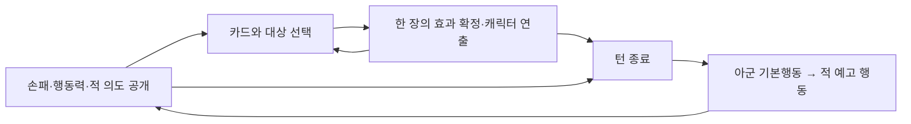

# 카드 전술과 캐릭터 교전 설계 v0.1

작성일: 2026-10-09

상태: 사용자가 요청한 방향 고도화를 위한 **검증 설계안**. 게임 코드에 적용한 규칙이나 최종 합의로 취급하지 않는다. 기존 풀오토 기획서와 저장된 원정은 그대로 두고, 별도 전투 실험에서 비교한다. 수치·파티 규모·연출 길이는 테스트 기본값이다.

## 1. 목표와 방향

플레이어는 현재 손패로 위험에 대응하고, 캐릭터는 선택한 전술을 자신의 움직임·기술·대사로 실행한다. 덱을 바꾸면 선택 가능한 해결책과 전투 장면이 함께 달라져야 한다.

- 슬더슬에서 가져올 중심: 손패와 제한된 자원을 보고 공격·방어·성장의 기회비용을 판단하는 과정, 원정 중 카드 선택과 덱 성장.
- 오토체스에서 유지할 요소: 파티 조합과 전투 전 배치, 조합이 전투에서 드러나는 경험. 전투 중 카드 결정은 새로 플레이어에게 맡긴다.
- 서브컬쳐 방향: 손패에 개인 카드가 없는 순간에도 캐릭터의 기본행동과 개성이 보이고, 선택한 기술은 그 캐릭터의 대표 장면으로 표현한다.

슬더슬의 판단과 끊기지 않는 풀오토 관전을 같은 강도로 제공할 수 있다고 가정하지 않는다. 이 안은 직접 카드 판단을 우선하며, 기존보다 전투가 자주 멈춘다.

## 2. 핵심 보완: 카드를 예약하지 않고 한 장씩 해결한다

여러 장을 예약한 뒤 AI가 실제 대상과 실행 순서를 결정하는 구조는 첫 후보에서 제외한다. 먼저 고른 카드가 적을 죽이거나 동료를 이동시키면 뒤의 카드가 무효가 될 수 있고, 플레이어가 결과를 이해하기 어려워지기 때문이다.

**카드 한 장 선택 → 대상 확인 → 효과와 연출 → 갱신된 전황에서 다음 카드 선택**을 반복한다. 플레이어가 턴을 끝내면 아군 기본행동과 적의 예고 행동을 실행한다.

결과는 확정된 규칙으로 계산하되, 화면에서는 효과가 실제 타격·보호·이동 장면과 함께 표시된다. 연출 완료 후에 다음 카드를 입력한다. 배속이나 연출 생략은 결과와 상태 지속시간을 바꾸지 않는다.

## 3. 한 턴의 규칙

| 구간 | 처리 | 플레이어에게 보이는 정보 |
|---|---|---|
| 시작 | 행동력 회복, 손패 뽑기, 적 의도 생성, 아군 기본행동 계획 | 적의 대상·피해·범위·실행 순서, 아군 기본행동 대상 |
| 카드 결정 | 사용 가능한 카드 한 장을 확인하고 즉시 해결 | 비용·효과·선택 후 남은 위협 |
| 카드 연출 | 시전자 이동·기술·대사 재생 | 선택한 대상에 효과가 발생하는 장면 |
| 다음 결정 | 새 상태에서 카드 선택 또는 턴 종료 | 갱신된 의도와 종료 시 피해 예측 |
| 아군 기본행동 | 생존한 아군이 파티 슬롯 순서대로 한 번씩 행동 | 행동 주체·대상·결과 |
| 적 행동 | 생존한 적이 공개한 순서대로 의도 실행 | 보호 흡수·피해·행동 취소 이유 |
| 정리 | 남은 손패 버리기, 턴 한정 효과 만료, 승패 확인 | 다음 턴에 남는 효과와 소모된 자원 |

결정 단계에는 기본공격·이동·명령 충전·적 쿨타임이 진행되지 않는다. 선택 시간 제한도 없다. 결정 단계에서는 카드를 사용하지 않고 바로 턴 종료를 선택할 수도 있다. 연출과 교전 처리 중에는 카드 사용·턴 종료의 중복 입력을 받지 않는다.

각 카드·기본행동·적 행동과 그 후속 효과가 모두 해결될 때마다 승패를 확인한다. 적이 모두 사라지거나 아군이 모두 전투불능이면 남은 교전·손패 보충을 중단한다. 같은 행동의 후속 효과로 양쪽이 모두 전투불능이면 첫 실험에서는 패배로 처리한다. 턴 정리는 다음 턴이 존재할 때만 진행한다.

### 기본값

| 항목 | 첫 검증 기본값 | 이유 |
|---|---|---|
| 파티 | 전체 방향은 현재 4인 기준, 첫 실험만 2인 | 처음에는 판단의 인과를 읽기 쉽게 한다 |
| 덱 | 전체 비교는 현재 20장, 첫 2인 실험은 고정 12장 | 파티 규모 실험과 정식 편성 규칙을 구분한다 |
| 손패 | 매 턴 5장 | 비교할 선택을 제한한다 |
| 행동력 | 파티 공용 3, 매 턴 회복, 이월 없음 | 카드 비용의 기회비용을 단순하게 만든다 |
| 카드 비용 | 1 또는 2만 사용 | 0비용 순환·복잡한 자원 변환은 첫 실험에서 제외한다 |
| 사용 후 보충 | 자동으로 뽑지 않음 | 사용한 카드가 계속 보충되어 한 턴이 길어지는 문제를 피한다 |
| 미사용 손패 | 턴 종료 시 버림 | 좋은 카드를 저장하기 위한 대기가 항상 유리해지지 않게 한다 |
| 리롤 | 첫 실험에는 없음 | 손패 판단 자체의 재미를 먼저 확인한다 |
| 기본행동 | 생존자마다 턴당 최대 1회 | 속도·초 단위 주기 대신 읽을 수 있는 결산을 제공한다 |
| 상태 지속 | 이번 적 행동 단계까지, 또는 명시한 턴 수 | 애니메이션 시간에 따라 보호가 만료되지 않게 한다 |

카드 사용이 수락되면 그 실물 카드를 손패에서 한 번만 소비하고, 효과 해결 후 버린 더미로 옮긴다. 해결 중 시전자가 전투불능이 된 카드는 대신 제외 더미로 옮긴다. 턴 종료 시 손패에 남아 있는 카드만 버린 더미로 이동한다.

뽑을 더미가 소진되면 버린 더미를 섞는다. 손패·제외 더미에 있는 같은 실물 카드를 중복해서 뽑지 않는다. 사용한 카드가 자동으로 즉시 다시 손패로 돌아오는 규칙은 없다. 드로우·보존 카드는 기본 흐름이 검증된 뒤 보상 선택으로 시험한다.

현재 카드의 회복시간 4초를 비용 1로 기계적으로 바꾸는 방식은 사용하지 않는다. 한 턴의 다른 카드·방어·기본행동·적 의도와 비교해 효과와 비용을 새로 정한다.

## 4. 예측 가능한 판정

### 적의 행동

적은 턴 시작에 공격·보호·강화 등 이번 행동을 공개한다. 공격은 대상, 피해, 횟수 또는 범위를 표시한다. 숨은 적 카드가 결정 단계 중 갑자기 끼어들지 않는다.

- 개체 대상 공격은 그 캐릭터를 계속 겨냥한다. 단순히 후열로 옮겼다고 해제되지 않는다.
- 구역 공격은 공개한 전열 또는 후열을 공격한다. 카드로 해당 구역을 떠나면 피할 수 있다.
- 도발·차단·결속 등 카드가 행동을 바꾸면 변경된 의도를 즉시 표시한다.
- 행동 주체가 죽거나 명시한 행동 불능 상태가 되면 해당 행동을 취소한다.
- 개체 대상이 사라지면 다른 대상으로 몰래 바꾸지 않는다. 해당 행동을 취소한다.
- 구역 공격 시 해당 구역에 아무도 없다면 피해 없이 끝난다.
- 현재 턴에 실행될 보스 전환·추가 행동은 함께 예고한다. 체력 경계 도달만으로 예고 없는 공격을 즉시 실행하지 않는다.

명중률이나 임의 표적 변경은 첫 실험에서 사용하지 않는다. 불확실성은 주로 다음 손패와 이후 전투·보상에서 얻는다.

### 기본행동의 계획

카드 하나를 해결할 때마다 아군 기본행동 계획과 턴 종료 예측을 현재 상태로 다시 계산해 표시한다. 턴 종료를 누르면 그 계획을 고정한다. 기본행동을 처리하는 도중 목표가 사라졌다면 해당 행동은 취소하고, 새 목표를 즉석에서 고르지 않는다.

적 의도는 카드가 명시적으로 변경한 경우에만 바뀐다. 아군 계획의 갱신과 적 의도의 고정을 혼동하지 않는다.

카드 사용 가능 여부·비용·대상은 확정 전에 검사한다. 잘못된 대상이나 부족한 비용 때문에 실행이 거절되면 카드를 버리거나 행동력을 소모하지 않는다. 카드가 수락된 뒤의 연출은 거리·충돌·준비시간 때문에 실패하지 않는다.

패시브·특성의 후속 효과도 같은 카드 결과의 일부로 해결한다. 첫 실험은 **하나의 원본 행동에서 각 패시브·특성이 각각 최대 1회** 발동하도록 제한한다. 후속 효과는 새로운 패시브·특성 연쇄를 만들지 않는다. 카드 여러 타격이 행동 여러 번으로 집계되지 않게 한다.

### 보호·상태·타격의 처리

- 보호는 피해를 받을 때마다 차감되는 합산 수치다. 보호 10은 총 피해 10까지 흡수하며 공격마다 새로 10을 막지 않는다. 여러 보호 카드는 남은 보호 수치에 더한다. 첫 실험의 보호는 적 행동 단계 종료 후 만료된다.
- 같은 약화·표식은 중첩하지 않고 더 강한 수치와 명시한 지속기간으로 갱신한다. 같은 결속 두 장이 피해를 계속 절반으로 만들거나 기술 피해 +16을 만들지 않는다. 달라지는 효과가 없는 재사용에는 이를 표시한다.
- ‘다음 기술 피해 +8’은 해당 적에게 가하는 다음 기술 공격의 첫 유효 타격에 한 번 적용하고 소비한다. 기본공격으로 소비하지 않고, 남아 있으면 이번 턴 정리 때 만료된다.
- 한 타격은 피해 보정 → 피해량 정수화(소수점 버림) → 보호 차감 → HP 피해 → 전투불능 판정 → 생존한 주체의 허용된 후속 효과 순서로 처리한다. 그 뒤 다음 타격으로 넘어간다.
- 반격으로 공격자가 죽으면 남은 타격을 취소한다. 다중 타격 도중 대상이 죽어도 명시한 전이 효과가 없다면 다른 적을 자동 공격하지 않는다. 이 취소와 후속 효과도 종료 예측에 포함한다.

## 5. 캐릭터의 존재감과 카드의 책임

기본행동은 캐릭터가 장면에서 사라지지 않게 하고, 카드는 전투의 중요한 돌파구를 만든다. 모든 카드를 기본공격 강화 버튼으로 바꾸지 않는다. 직접 공격·보호·회복·위치 변경을 모두 유지한다.

| 구성 | 책임 | 예시 |
|---|---|---|
| 기본행동 | 손패와 무관하게 작은 역할을 수행 | 낮은 피해의 베기, 소량의 보호·회복 |
| 고유 패시브 | 같은 카드 기능을 캐릭터답게 연결 | 보호가 실제로 성립한 뒤 제한된 반격 |
| 전용 카드 | 그 캐릭터의 대표 전술과 장면 | 결속, 돌진, 동료 견인 |
| 공유 카드 | 새 전용 카드 대량 제작 없이 기능 제공 | 편성 시 지정한 캐릭터가 사용하는 엄호·약화 |
| 궁극기 | 준비한 전술을 큰 장면으로 완성 | 준비 조건과 비용을 가진 대표 기술 |

전용 카드는 시전자가 고정된다. 공유 카드도 현재 방식처럼 편성할 때 시전자를 지정한다. 카드를 사용할 때마다 적합한 시전자를 다시 찾는 절차는 추가하지 않는다.

초기 제작 규모는 캐릭터당 기본행동 1개, 패시브 1개, 시작 전용 카드 2~3종을 목표로 한다. 원정 보상은 대표 기능을 다른 방식으로 쓰게 하는 소수의 카드·진화로 구성한다. 기본 기능을 얻기 위해 추가 캐릭터 구매나 보상 획득이 필요한 구조는 만들지 않는다.

### 기본행동의 밸런스

피해 담당 캐릭터의 기본행동 피해는 작은 고정값으로 시작한다. 일반적인 턴에서 피해의 대부분은 카드 선택으로 발생하게 한다. 유효 피해의 약 15~25%를 기본행동이 담당하는 범위는 첫 조정 목표이며, 적과 덱에 따라 달라질 수 있는 관찰값이다.

자동 회복·보호가 적의 공격을 계속 상쇄해 턴 종료만 반복해도 안전해지는 상황을 별도로 확인한다. 기본행동은 독립적인 강력한 기술·무제한 회복·새 행동력을 생성하지 않는다.

해당 캐릭터 카드가 없으면 기본행동으로 존재감을 보여주되, 매 턴 모든 캐릭터에게 강한 기술을 보장하지 않는다. 파티 공용 자원을 누구에게 배분할지도 판단의 일부다.

### 전투불능과 손패

전투불능 시 해당 시전자의 카드는 이번 전투의 별도 제외 더미로 옮긴다. 카드 결정 단계에서 발생했다면 현재 손패에서 제외된 만큼 남은 유효 카드로 보충하되, 물리적으로 다른 카드가 부족하면 작은 손패로 진행한다. 아군 기본행동·적 행동 단계에서는 즉시 보충하지 않고 다음 턴 시작에 정상적으로 뽑는다. 더미를 다시 섞어도 제외 카드는 돌아오지 않는다.

이 제외는 원정 카드의 영구 삭제가 아니다. 다음 전투에서 캐릭터가 복귀하면 원래 편성에 따라 돌아온다. 첫 실험에는 전투 중 부활을 넣지 않는다. 모두 전투불능이면 보충 처리 전에 패배한다.

특성 편성 단계는 전투 중 사망으로 재계산하지 않는다. 다만 사망한 캐릭터의 행동과 전용 조건은 발동할 수 없다. 사망에 따른 덱 압축이 오히려 유리해지는 조합은 검증 대상으로 기록한다.

### 궁극기는 기본 흐름 검증 이후

첫 비교 전투는 궁극기 없이 카드 판단을 검증한다. 다음 실험에서는 새 게이지 체계를 추가하기보다 **자신의 유효 기술 카드 2회 사용 후 준비, 전투당 1회, 공용 행동력 2 소비**를 하나의 임시 규칙으로 시험한다. 유효 기술은 실제 피해·회복·보호 제공 또는 위치·상태의 변경이 발생한 것으로 정의한다.

궁극기는 준비되면 초상화 옆에 나타나는 고정된 선택지이며 무작위 손패를 점유하지 않는다. 준비돼도 플레이어가 사용을 선택한다. 별도 행동 횟수 제한이나 타이밍 입력을 겹쳐 요구하지 않는다. 이 준비 규칙은 기존 궁극기 게이지의 최종 대체안이 아니며, 두 방식 중 하나만 실험한다.

## 6. 위치와 움직임

첫 전투는 전열·후열만 판정에 사용한다. 각 열은 세 칸으로 구성해 4인 파티에서도 이동할 빈 칸을 남긴다. 첫 실험의 이동 카드는 빈 칸이 있는 반대 열로 아군 한 명을 옮긴다. 같은 열의 칸 차이는 첫 실험에서 효과에 영향을 주지 않는다. 이동할 수 없는 카드에는 이유를 표시한다. 전투 중 자유 드래그와 캐릭터별 이동 명령은 추가하지 않는다.

일반 공격을 연출하기 위한 접근·돌진은 논리적 배치를 바꾸지 않는다. **접근 → 기술 → 원래 배치로 복귀**한다. 실제 배치를 바꾸는 카드는 이동 후 새 위치에 남고 전열·후열 표시도 바뀐다.

이동의 전략 효과는 세 가지부터 확인한다.

1. 예고된 구역 공격을 피한다.
2. 명시한 열의 범위 보호·회복 안으로 들어간다.
3. 전열 우선 표적 등 다음 턴의 대상 선정에 영향을 준다.

계속 뛰어다니는 실시간 좌표가 카드의 사거리나 보호 성공 여부를 바꾸게 하지 않는다. 기존 넓은 배치 보드는 추후 위 세 효과가 충분히 재미있고 이해 가능한지 확인한 뒤 다시 연결한다.

## 7. 모든 카드의 특성을 유지하되 자원을 늘리지 않는다

모든 카드가 특성을 가진다는 기존 원칙을 유지한다. 원본 카드 종류 기준의 편성 단계와 원정 내 성장도 유지한다. 특성마다 별도 게이지·새 행동력·독립 쿨타임을 추가하지 않는다.

| 특성 | 전술 방향 | 첫 연결 후보 |
|---|---|---|
| 호위 | 방어를 공격 기회로 바꿈 | 이번 턴에 실제 피해를 막은 뒤 제한된 반격 |
| 추격 | 약화한 적에게 공격을 집중 | 표식에 대한 다음 기술 공격 강화 |
| 공명 | 다른 캐릭터의 기술을 연결 | 서로 다른 캐릭터가 연속 사용한 기술의 보조 효과 강화 |

카드의 특성 설명과 실제 발동 규칙은 일치시킨다. 예상 발동은 카드 선택 시 보여주고, 실제 발동은 결과 기록으로 남긴다. 단일 캐릭터 집중 덱도 실행 가능하게 하되 다른 특성 운영과 비용을 비교한다.

첫 고정 전투에서는 모든 카드에 특성을 표시하되 단계 보너스를 끄고, 두 번째 실험에서 한 특성씩 연결한다. 카드의 재미와 특성 보너스의 재미를 따로 확인하기 위한 테스트 조건이며, 정식 게임에서 특성 없는 카드를 만드는 뜻이 아니다.

## 8. 원정과 성장

원정 중 보상 카드 선택·교체·보관·넘기기, 휴식·진화 경로, 원정 종료 시 보상 카드와 진화 초기화는 활용한다. 카드 수와 획득 경로를 이번 변경과 동시에 다시 늘리지 않는다.

보상은 다음 턴부터가 아니라 **보상을 받은 다음 전투부터** 편성해 사용한다. 전투 중 새 카드 획득이나 덱 교체는 첫 범위에 없다.

성장은 수치 증가뿐 아니라 해결 방법의 변화로 보여준다.

- 공격 카드 획득: 이전에 살아남던 적을 이번 턴에 처치할 수 있다.
- 견인·엄호 획득: 공격을 견디는 방식에서 피해 자체를 피하거나 돌리는 방식으로 바뀐다.
- 연계 카드 획득: 서로 다른 캐릭터에게 행동력을 배분할 이유가 생긴다.
- 보존·드로우 획득: 이후 단계에서 손패의 불확실성을 관리하는 방법을 얻는다.

진화는 한 번만 가능하며 같은 원정에만 남는다. 공격 수치 증가와 새 전술 효과 중 무엇을 줄지는 작은 카드 풀에서 먼저 확인한다.

## 9. 한 턴 예시 — 테스트용 수치와 능력

이 예시는 프롤로그 캐릭터의 능력을 활용한 전투 실험이다. 정식 능력 목록·서사·세계관 규칙을 확정하지 않는다.

상황: 도윤은 후열, 하린은 전열. 사냥꾼은 HP 28로 하린에게 피해 12를 예고한다. 주술사는 후열 전체에 피해 8을 예고한다. 두 아군의 기본공격은 사냥꾼을 우선하며 피해 2와 3이다. 행동력은 3이다.

| 손패 | 비용 | 테스트 효과 | 특성 |
|---|---|---|---|
| 결속 | 1 | 사냥꾼의 이번 공격 피해 절반, 다음 기술 공격 피해 +8 한 번 | 추격 |
| 충격참 | 2 | 적 한 명에게 피해 20 | 추격 |
| 엄호 | 1 | 아군 한 명에게 이번 적 행동까지 보호 10 | 호위 |
| 견인 | 1 | 아군 한 명을 반대 열의 빈 칸으로 이동 | 호위 |
| 짧은 베기 | 1 | 적 한 명에게 피해 10 | 공명 |

**공격 선택:** 결속 → 충격참으로 피해 28을 주어 사냥꾼을 처치한다. 하린 대상 공격은 취소된다. 아군 기본행동 계획은 주술사를 겨냥하도록 갱신되지만, 주술사의 후열 공격은 남아서 도윤이 피해 8을 받는다.

**보호 선택:** 하린 엄호 → 도윤을 전열로 견인 → 사냥꾼에게 짧은 베기. 사냥꾼은 기본공격까지 받은 뒤 HP 13이 남고 하린에게 공격한다. 보호가 10을 막아 하린이 피해 2를 받는다. 후열이 비어 주술사의 구역 공격은 피해 없이 끝난다. 생존을 얻지만 다음 턴에도 적 두 명이 남는다.

손패가 강한 카드 순서만 정하는 문제가 되지 않게, 남은 HP·다음 턴·전투 이후 회복 비용이 두 선택의 가치에 영향을 줘야 한다. 첫 튜토리얼은 두 선택의 결과를 읽게 하고 특정 정답만 강제하지 않는다. 원본 프롤로그의 고정 시퀀스는 저자 의도와 별개로 유지하며, 이 실험이 그 장면을 자동 변경하지 않는다.

## 10. 화면과 연출

전투 배경은 화면 전체를 차지한다. 정보 패널이 나타나거나 스킬 문구가 출력돼도 전장 크기를 바꾸지 않는다.

- 상단: 턴, 적 의도, 이번에 받을 위협. 적 위의 아이콘은 대상·피해·범위를 같은 형식으로 표시한다.
- 하단: 손패 5장, 남은 행동력, 턴 종료. 카드에 시전자 초상화·비용·효과·특성·대상을 표시한다.
- 카드 선택: 대상 강조, 예상 피해·보호·이동과 바뀔 적 의도를 보여준다. 상세 설명은 필요할 때 연다.
- 초상화: HP·핵심 상태만 상시 표시한다. 궁극기는 해당 실험에서 준비됐을 때 선택지를 추가한다.
- 턴 종료 예측: 결정에 필요한 피해·보호·처치 결과를 확인할 수 있다. 계산되지 않은 결과를 안전하다고 표시하지 않는다.

낮은 중요도 기술은 짧은 동작과 효과, 대표 기술은 초상화·짧은 대사·강조 타격, 궁극기는 한 단계 큰 연출을 사용한다. 일반 카드 연출 약 0.5~1초, 대표 기술 약 1~2초를 테스트 목표로 두되 스킵·배속을 지원한다. 새 일러스트는 임시 도형이나 기존 자산으로 시험한다.

결정 단계에서는 정지한 인형처럼 보이지 않도록 호흡·시선·대기 자세만 움직인다. 이 동작은 게임 상태를 진행하지 않는다. 중요한 카드의 연출이 다른 캐릭터의 의미 없는 자동 공격에 가리지 않게 한다.

## 11. 기존 시스템 처리

| 처리 | 시스템 | 이유 |
|---|---|---|
| 재사용 | 카드/시전자 식별, 캐릭터 기본 키트, 그림·연출, 보상 비교, 덱 편집, 원정 경로, 결과 통계 | 새 판단 구조에도 직접 연결된다 |
| 수정 | 초 단위 보호·결속·회복시간, 적 예고, 이동·범위 판정, 특성 발동 | 턴과 공개된 결과로 다시 정의해야 한다 |
| 새 핵심에서 제외 | 공유 명령 충전, 카드별 회복시간, 무한 기본행동, 전투 중 카드 선택 AI, 대기 버튼 | 공용 행동력과 턴 종료가 기회비용을 맡는다 |
| 다음 검증으로 보류 | 궁극기, 드로우/보존 카드, 넓은 배치판, 실시간 재타겟, 복잡한 적 전용 덱 | 여러 변경의 재미와 문제를 동시에 섞지 않는다 |
| 별도 비교 조건으로 유지 | 현재 풀오토 전투·기록·연습 | 기존 방향과 비교할 기준이 필요하다 |

기존 역할/캐릭터 AI는 작은 기본행동 계획과 동작 실행에 활용할 수 있다. 새 카드마다 최고 가치 평가식을 작성할 필요는 줄어든다. 대신 카드 규칙·예측·연출이 같은 결과를 표현하도록 관리한다.

기존 실시간 전투를 멈췄다가 일정 초 동안 흘리는 방식으로 흉내 내지 않는다. 애니메이션과 무관하게 같은 행동을 정확히 한 번 처리하는 턴 전투 상태가 필요하다. 저장·복원과 연습 기록은 새 규칙 버전을 분리해야 한다.

## 12. 위험과 확인할 것

| 위험 | 관찰 신호 | 조정 |
|---|---|---|
| 자동행동이 판단을 대신함 | 카드 없이 턴 종료만으로 쉽게 승리·회복 | 기본행동을 낮추고 같은 조건의 카드 없는 진행과 비교 |
| 공격만 하는 것이 최적 | 모든 손패에서 최대 피해 선택이 반복됨 | 공격 예고·구역 위협·다음 턴 비용을 조정하고 보호 선택을 비교 |
| 완벽 방어로 전투가 정체됨 | 피해 없는 방어 반복이 늘 최선 | 공개된 강화·충전 의도를 가진 적을 한 종류 시험 |
| 연출 때문에 판단이 끊김 | 입력보다 대기 시간이 더 불편함 | 일반 연출 축소·배속·스킵, 판정에는 영향 없음 |
| 다중 캐릭터가 무의미함 | 한 명의 카드만 사용하고 나머지는 장식 | 비용·기능·위협을 조정하고 다른 인원의 연계를 비교 |
| 선택이 잘못 전달됨 | 대상 변경·이동·특성 발동 이유를 설명하기 어려움 | 공개 정보와 예측을 먼저 보완, 추가 시스템을 멈춤 |
| 사망이 덱 압축 보상으로 작동 | 특정 동료를 먼저 죽이는 구성이 유리함 | 손실 기능과 제외 규칙을 점검, 자동 대체 카드 도입은 별도로 검토 |

총 피해 비중만으로 재미를 판정하지 않는다. 같은 손패에서 다른 행동 순서·대상이 실제로 다른 결과를 만들고, 그 이유를 플레이어가 이해하는지를 확인한다.

## 13. 검증 순서

1. **고정 전투 한 개:** 2인·고정 덱·손패·적 의도, 기본 카드만 사용. 공격 우선과 보호 우선의 서로 다른 해법을 확인한다. 궁극기·특성 보너스·원정 성장 없이 판단 흐름부터 만든다.
2. **반복 전투 한 개:** 같은 적에 여러 손패와 두 덱을 적용한다. 카드 순서·대상·턴 종료, 기본행동 비중·전투 시간·예측 오차를 기록한다. 기존 풀오토는 별도의 관전 방식으로 비교하고 승률만으로 우열을 결론내리지 않는다.
3. **짧은 원정:** 3전투와 두 번의 보상으로 덱 변화가 새 해법을 만드는지 확인한다. 특성을 하나씩 연결하고, 카드 교체의 기회비용을 읽을 수 있게 한다.
4. **캐릭터 확장:** 4인·현재 덱 20장으로 확장한 뒤 궁극기 한 캐릭터만 시험한다. 작은 실험 결과를 그대로 최종 밸런스로 간주하지 않는다.

현재 요청에서는 이 설계까지 고도화한다. 구현 시작 시에는 1번의 별도 전투 실험을 먼저 만들며, 기존 게임 전체를 한 번에 전환하지 않는다.

## 14. 참고와 설계자의 판단

- [Slay the Spire 공식 소개](https://store.steampowered.com/app/646570/Slay_the_Spire/): 매 원정 카드 선택과 시너지, 경로 위험과 보상을 참고한다. 위 턴 규칙과 수치는 본 프로젝트의 제안이다.
- [Chrono Ark 공식 소개](https://store.steampowered.com/app/1188930/Chrono_Ark/): 파티 RPG와 카드 덱빌딩이 결합하고 캐릭터의 기술이 카드로 표현되는 구성을 참고한다. 개별 캐릭터 제작량과 전투불능 처리는 본 제안이다.
- [Midnight Suns 리드 디자이너 설명](https://blog.playstation.com/2022/10/26/marvels-midnight-suns-super-heroic-turn-based-combat-and-card-tactics-explained/): 강력한 캐릭터 기술이 정해진 결과를 내면서 손패의 제약으로 전술 문제를 만드는 원리, 선택한 기술의 자동 접근 연출을 참고한다. 본 안의 자동 기본행동과 전열·후열은 해당 게임의 규칙을 그대로 옮긴 것이 아니다.

이 조합이 재미있다는 결론은 아직 없다. 검증 목표는 **다음 손패를 보고 또 판단하고 싶은가**, **선택한 카드가 매력적인 캐릭터의 행동으로 읽히는가**, **새 덱이 이전에 없던 해결책을 주는가**다.
